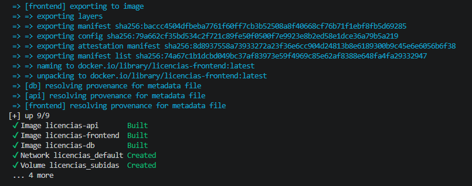
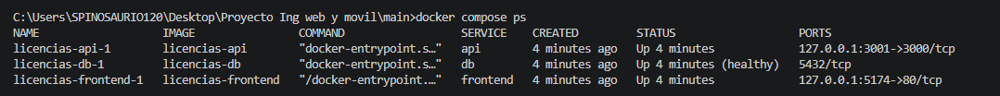
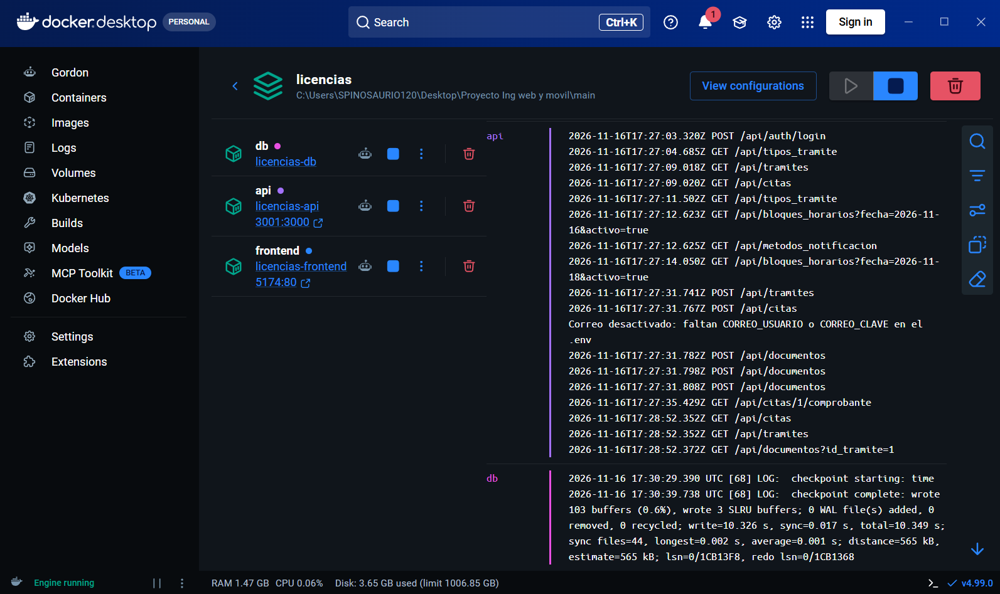
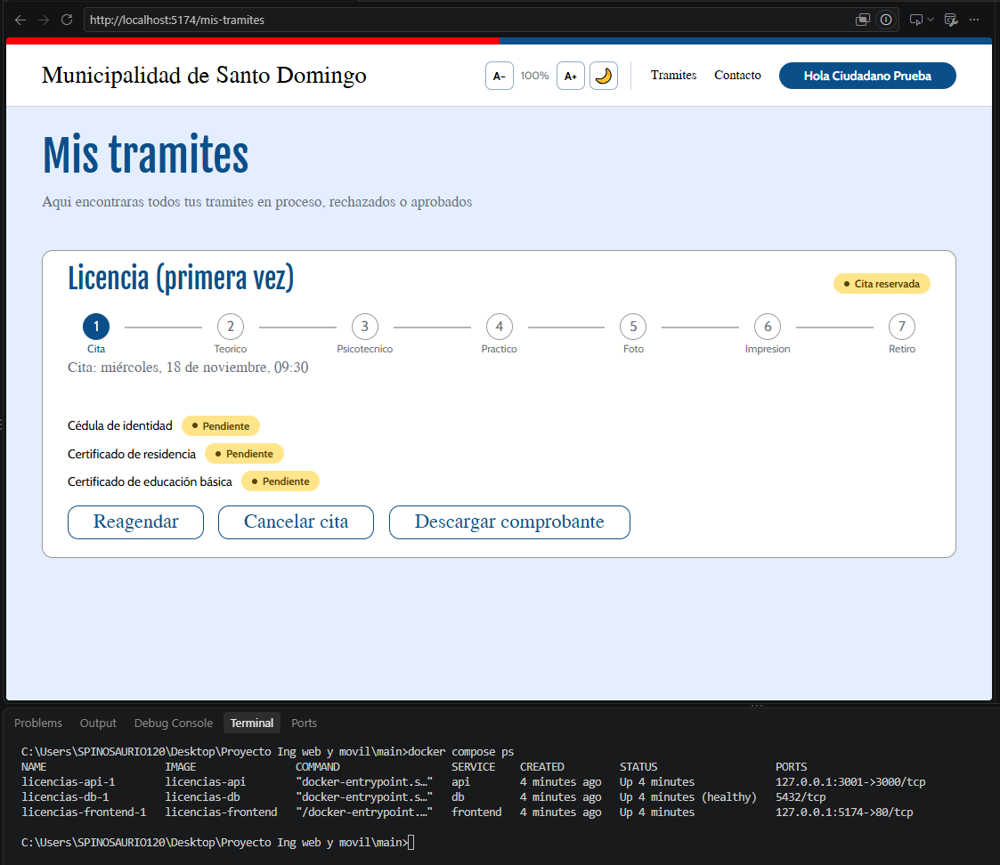

# Sistema de gestión de trámites en línea: Entrega Final

Documentación de la Entrega Final del proyecto. La presentación general del sistema y sus ramas está en el [README principal](README.md).

## Ejecución con Docker

Con Docker se levanta el sistema completo con un solo comando: la base de datos PostgreSQL, la API y el frontend. Cada parte se construye desde su rama en GitHub, así que basta con clonar `main`.

Para ejecutar el backend y el frontend por separado sin Docker, los pasos están en la sección 5 del [README de `backend-EP2`](https://github.com/CristobalFloresH/Sistema_Gestion_De_Transmites_En_Linea/tree/backend-EP2).

### Servicios

| Servicio | Imagen base | Dirección | Configuración |
|---|---|---|---|
| `db` | `postgres:18-alpine` | Solo dentro de Docker | Ejecuta [`licencias.sql`](https://github.com/CristobalFloresH/Sistema_Gestion_De_Transmites_En_Linea/blob/backend-EP2/backend/base%20de%20datos/licencias.sql) al crear la base por primera vez |
| `api` | `node:24-bookworm-slim` | `http://localhost:3001/api` | [`backend/Dockerfile`](https://github.com/CristobalFloresH/Sistema_Gestion_De_Transmites_En_Linea/blob/backend-EP2/backend/Dockerfile) |
| `frontend` | `nginx:stable-alpine` | `http://localhost:5174` | [`frontend/Dockerfile`](https://github.com/CristobalFloresH/Sistema_Gestion_De_Transmites_En_Linea/blob/frontend-EP2/frontend/Dockerfile) y [`nginx.conf`](https://github.com/CristobalFloresH/Sistema_Gestion_De_Transmites_En_Linea/blob/frontend-EP2/frontend/nginx.conf) |

Los puertos son distintos a los de `npm run dev` (3000 y 5173), así que se pueden usar los dos modos a la vez. Los datos de la base y los PDF subidos quedan en los volúmenes `datos-postgres` y `subidas`, y se conservan al apagar o recrear los contenedores. La orquestación completa está en [`docker-compose.yml`](docker-compose.yml).

### Requisitos

- Git
- Docker Desktop en Windows o Mac, o Docker Engine con Compose en Linux

**Instalar Docker Desktop en Windows:**
1. Verificar la virtualización: Administrador de tareas → Rendimiento → CPU → "Virtualización: Habilitado". Si dice deshabilitado, activarla en la BIOS (Intel VT-x o AMD-V/SVM).
2. En PowerShell como administrador: `wsl --install --no-distribution`
3. Reiniciar Windows con **Reiniciar**, no con Apagar. Con el inicio rápido de Windows, apagar y prender no aplica los cambios.
4. Descargar [Docker Desktop](https://www.docker.com/products/docker-desktop/) e instalarlo con las opciones por defecto (WSL 2).
5. Abrir Docker Desktop y esperar a que diga "Engine running". La primera vez tarda unos minutos.
6. Comprobar con `docker run hello-world` (Opcional).

### Pasos

1. Clonar la rama `main`:
   ```
   git clone -b main https://github.com/CristobalFloresH/Sistema_Gestion_De_Transmites_En_Linea.git
   cd Sistema_Gestion_De_Transmites_En_Linea
   ```
2. Crear el archivo `.env` a partir del ejemplo y completar `DB_PASSWORD` y `JWT_SECRET`. Las variables de WhatsApp y correo son opcionales: sin ellas el sistema funciona y solo no envía avisos.
   ```
   copy .env.ejemplo .env
   ```
3. Levantar el sistema. La primera vez construye las imágenes y tarda uno o dos minutos:
   ```
   docker compose up -d --build
   ```
4. Revisar que los tres servicios estén arriba, con `db` en estado healthy:
   ```
   docker compose ps
   ```
5. Abrir `http://localhost:5174` y entrar con un usuario de prueba:

| Rol | RUT | Contraseña |
|---|---|---|
| Ciudadano | `20123456-5` | `Clave123!` |
| Funcionario | `12345678-5` | `Clave123!` |
| Administrador | `11111111-1` | `Clave123!` |

### Comandos útiles

| Comando | Qué hace |
|---|---|
| `docker compose up -d --build` | Construye las imágenes y levanta los servicios en segundo plano |
| `docker compose ps` | Muestra el estado de los servicios |
| `docker compose logs -f api` | Muestra en vivo lo que registra la API (se sale con Ctrl+C) |
| `docker compose down` | Apaga los servicios y conserva los datos |
| `docker compose down -v` | Apaga los servicios y borra la base y los PDF. Al volver a levantar, la base parte desde cero |
| `docker compose exec api npm run recordatorios` | Envía los recordatorios de las citas de las próximas 24 horas |

### Problemas frecuentes

| Problema | Solución |
|---|---|
| Docker Desktop muestra "Virtual Machine Platform is not enabled" | En PowerShell como administrador ejecutar `Enable-WindowsOptionalFeature -Online -FeatureName VirtualMachinePlatform -All -NoRestart` y `Enable-WindowsOptionalFeature -Online -FeatureName Microsoft-Windows-Subsystem-Linux -All -NoRestart`, y reiniciar con Reiniciar |
| `docker` no se reconoce como comando | Abrir una terminal nueva después de instalar Docker Desktop |
| Error de conexión al ejecutar `docker compose` | Docker Desktop no está abierto o el motor todavía no termina de iniciar |
| "Port is already allocated" | Otro programa usa el puerto 3001 o 5174. Cerrarlo o cambiar el puerto en `docker-compose.yml` |
| Cambios del código que no aparecen | Las imágenes se construyen desde GitHub: hay que subir los cambios y volver a ejecutar `docker compose up -d --build` |
| Se cambió `DB_PASSWORD` y la API no se conecta | La contraseña se fija al crear la base. Ejecutar `docker compose down -v` y volver a levantar |

### Evidencia

| Construcción de las imágenes | Servicios en ejecución |
|---|---|
|  |  |

Docker Desktop con los tres contenedores y los registros de la API durante una reserva completa:



Aplicación funcionando en `http://localhost:5174`:



