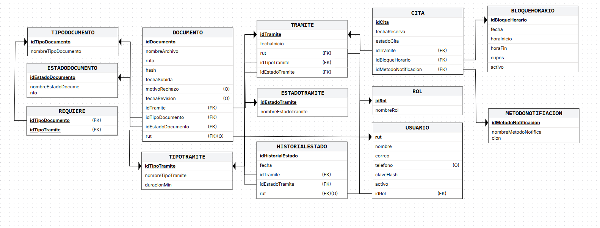
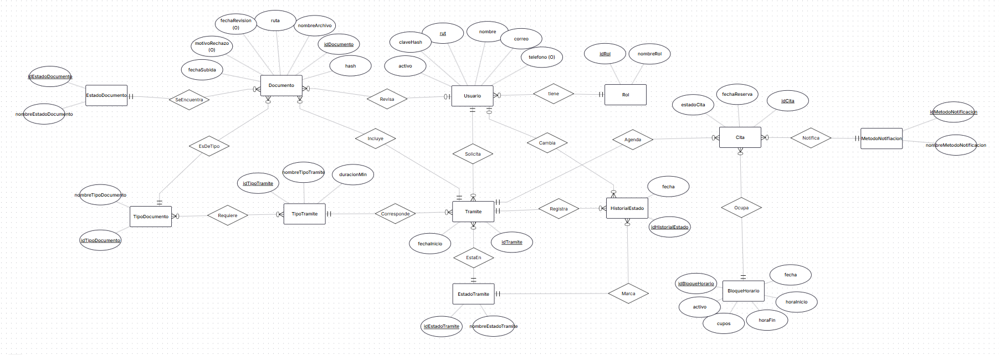

# Proyecto_Final_INF3245

<<<<<<< HEAD
## Índice
1. [Justificación del problema](#justificación-del-problema)
2. [Usuarios](#usuarios-objetivo)
   - [Roles](#roles-del-sistema)
   - [Proto-personas](#proto-personas)
3. [Requerimientos funcionales](#requerimientos-funcionales)
4. [Requerimientos no funcionales](#requerimientos-no-funcionales)
5. [Arquitectura de navegación](#Arquitectura-de-navegación)
   - [Diferenciación de acceso por rol](#diferenciación-de-acceso-por-rol)
   - [Flujo de tareas principales](#flujo-de-tareas-principales-task-flows)
   - [Puntos críticos de interacción](#puntos-críticos-de-interacción)
   - [Justificación técnica de las decisiones](#justificación-técnica-de-las-decisiones)
6. [Figma](#Figma)

---

## Justificación del problema

La madurez digital de los municipios en Chile avanza de manera progresiva, impulsada por la necesidad de ofrecer servicios públicos más eficientes y conectados con la ciudadanía. Sin embargo, a pesar de que el 90 % de las municipalidades ya permite realizar trámites clave como el pago del permiso de circulación online ([Fundación País Digital, 2025](https://ww2.movistar.cl/empresas/comunidad/Informe-Municipios-TL-REV.pdf)), todavía enfrentan importantes desafíos estructurales para consolidar una gestión 100 % digital.

Una de las principales dificultades radica en que la implementación tecnológica ha sido desigual y fragmentada, lo que limita la capacidad de respuesta institucional frente a las exigencias de la Ley de Transformación Digital del Estado (Ley 21.180). Dicha normativa exige que todos los organismos públicos implementen sistemas totalmente digitales antes de 2027, eliminando el papel y garantizando la interoperabilidad de expedientes.

Además, el primer [Estudio de Madurez Digital de Municipalidades](https://ww2.movistar.cl/empresas/comunidad/Informe-Municipios-TL-REV.pdf) (realizado por Movistar Empresas, Fundación País Digital y Fortinet) revela áreas críticas que frenan este proceso. Entre ellas destacan la falta de planificación estratégica (apenas un 6 % cuenta con un plan definido), el déficit en la capacitación del personal en competencias digitales (solo un 16 %), las limitaciones en interoperabilidad y gestión documental (menos del 20 %), y la urgencia de fortalecer los protocolos de ciberseguridad.

En este escenario, uno de los cuellos de botella más evidentes a nivel municipal es la gestión del proceso de licencias de conducir. Actualmente, la baja disponibilidad de agendamiento online para este trámite genera aglomeraciones, largas filas y una alta congestión en la atención presencial. En el caso específico de la Municipalidad de Santo Domingo, la falta de un sistema digital integrado dificulta la toma de horas, el seguimiento del estado de los trámites y la recepción segura de documentos, afectando la experiencia de los ciudadanos y sobrecargando al personal interno.

Por lo tanto, el problema abordado por el proyecto corresponde a la brecha digital y operativa en la gestión de licencias de conducir de la Municipalidad de Santo Domingo, la cual dificulta la eficiencia del servicio y la vinculación ágil con la ciudadanía, alejando al municipio de los estándares requeridos por la Ley 21.180.

Para dar respuesta a esta problemática, se propone el desarrollo e implementación de una plataforma web centralizada orientada específicamente a la gestión integral de licencias de conducir. Este sistema permitirá optimizar la toma de horas en línea, realizar un seguimiento transparente de los estados del trámite, facilitar la subida y validación de documentos digitales, y dotar a los funcionarios de herramientas administrativas eficientes para el control de todo el flujo.

La propuesta no busca reemplazar por completo la atención institucional, sino constituir un mecanismo tecnológico de apoyo que agilice los procesos internos y reduzca la carga presencial. A través de una interfaz intuitiva y accesible desde diferentes dispositivos, se busca guiar al municipio hacia un nivel óptimo de digitalización y mejora continua.

En definitiva, el desarrollo de esta plataforma web para la Municipalidad de Santo Domingo permitirá centralizar la gestión de uno de los trámites más críticos, acelerar el cumplimiento de la Ley de Transformación Digital y proporcionar una experiencia de interacción más transparente, segura, rápida y cercana entre el municipio y sus ciudadanos.

---

## Usuarios objetivo 

La caracterización de usuarios y las proto-personas de este documento corresponden a una caracterización preliminar, elaborada a partir de fuentes secundarias (Ley 21.180 y Estudio de Madurez Digital de Municipalidades) y de supuestos razonados del equipo. No corresponden a resultados obtenidos de entrevistas ni de usuarios reales.

La aplicación considera principalmente dos grupos de usuarios: ciudadanos y funcionarios municipales. Adicionalmente, se contempla un rol de administración para la gestión general y técnica de la plataforma en la Municipalidad de Santo Domingo.

### Ciudadanos

Los ciudadanos corresponden a los usuarios finales y principales beneficiarios de la plataforma. Se considera que constituyen un grupo diverso respecto a su edad, familiaridad con la tecnología, disponibilidad de tiempo y necesidades de accesibilidad para realizar trámites presenciales o digitales.

Dentro de este grupo pueden existir ciudadanos que:

- Realizan trámites por primera vez o renuevan su licencia de conducir.
- Requieren agendar horas de atención según su disponibilidad laboral o personal.
- Necesitan revisar con claridad los requisitos y documentos obligatorios antes de asistir.
- Presentan diferentes niveles de experiencia con plataformas web o gubernamentales.
- Requieren conocer el estado actual de su trámite sin necesidad de llamar o ir al municipio.
- Suben y digitalizan documentos desde diferentes dispositivos (teléfonos móviles o computadores).
- Necesitan una estructura clara y predecible de navegación para evitar confusiones.
- Requieren reducir la cantidad de información presentada simultáneamente en pantalla.
- Presentan dificultades de movilidad o tiempo para realizar trámites de manera presencial.
- Pueden requerir asistencia o instrucciones muy concretas en cada etapa del proceso.

La población objetivo considera también a adultos mayores y personas con menor alfabetización digital, reconociendo que pueden requerir interfaces más intuitivas, tipografías claras y procesos guiados paso a paso.

La plataforma deberá evitar asumir que todos los usuarios poseen el mismo dominio tecnológico. En su lugar, ofrecerá alternativas claras de navegación, soporte visual y accesibilidad multiplataforma.

Necesidades principales de los ciudadanos:

- Agendar horas de atención para licencias de conducir de forma rápida y sin filas.
- Consultar en tiempo real el estado en el que se encuentra su trámite.
- Subir documentos obligatorios (fotografías, certificados, antecedentes) de manera online.
- Recibir notificaciones claras sobre las siguientes etapas o correcciones necesarias.
- Acceder a la plataforma desde computadores y dispositivos móviles indistintamente.
- Disponer de instrucciones sencillas, concretas y directas en cada paso.
- Visualizar requisitos previos claros para evitar rechazos en las pruebas médicas o teóricas.
- Reducir la incertidumbre mediante un seguimiento transparente del proceso.
- Contar con una navegación consistente y predecible.
- Disminuir los tiempos de espera y la necesidad de traslados presenciales innecesarios.


### Funcionarios Municipales

Los funcionarios municipales corresponden al personal de la Municipalidad de Santo Domingo encargado de gestionar, revisar y dar curso a los trámites de licencias de conducir. A diferencia de los ciudadanos, este grupo utiliza la plataforma de manera intensiva y continua durante su jornada laboral, por lo que sus necesidades están orientadas a la eficiencia, el orden y el control del flujo de trabajo diario.

Dentro de este grupo pueden existir funcionarios que:

- Atienden un alto volumen de solicitudes y expedientes durante el día.
- Necesitan visualizar rápidamente la agenda de citas de cada jornada.
- Revisan documentos digitales que antes recibían en papel, por lo que requieren que la visualización en pantalla sea clara y confiable.
- Deben validar la veracidad y el cumplimiento normativo de los documentos adjuntados por los ciudadanos.
- Requieren ubicar expedientes específicos de forma rápida, sin depender de archivos físicos.
- Necesitan mantener actualizado el estado del trámite en cada etapa del proceso.
- Presentan distintos niveles de experiencia con sistemas digitales, ya que algunos provienen de procesos manuales o semidigitalizados.
- Requieren que el sistema entregue retroalimentación clara ante cada acción realizada (aprobar, rechazar, actualizar estado).
- Necesitan minimizar el tiempo dedicado a tareas repetitivas para poder atender más casos.

La plataforma deberá considerar que los funcionarios no solo consumen información, como los ciudadanos, sino que además la generan y validan. Por ello, la interfaz para este rol debe priorizar la rapidez operativa, la trazabilidad de las acciones y la reducción de errores humanos en la gestión de expedientes.

Necesidades principales de los funcionarios:

- Visualizar la agenda diaria de citas de forma clara y ordenada.
- Revisar en línea los documentos adjuntados por los ciudadanos sin necesidad de imprimirlos.
- Aprobar o rechazar documentos dejando registro del motivo.
- Buscar expedientes y solicitudes ingresando el RUT del ciudadano.
- Consultar el historial completo de trámites de un ciudadano.
- Actualizar el estado del trámite conforme avanza en sus distintas etapas.
- Contar con una interfaz eficiente que reduzca los pasos necesarios para completar cada acción.
- Recibir confirmación visual clara de que una acción quedó correctamente registrada.

Necesidades de seguridad y privacidad

- Los vecinos entregan datos personales sensibles (RUT, certificados, antecedentes), por lo que necesitan confianza en que solo el personal autorizado podrá verlos.
- Los funcionarios solo deben acceder a los expedientes que corresponden a su función, y cada acción (aprobar, rechazar) debe quedar registrada.
- Se solicitarán únicamente los datos necesarios para realizar el trámite.


---
## Roles del sistema
•Ciudadano: agenda, reprograma o cancela su hora, sube sus documentos, consulta el estado de su trámite en la línea de tiempo y descarga su comprobante.

•Funcionario municipal: revisa la agenda diaria, visualiza y valida (aprueba o rechaza) los documentos, busca expedientes por RUT, actualiza el estado del trámite y consulta el historial de cada ciudadano.

•Administrador: gestiona la plataforma a nivel general y técnico: crea y desactiva cuentas de funcionarios, configura los bloques horarios disponibles y supervisa el funcionamiento del sistema.

---
## Proto-personas

### Proto-persona 1: Ciudadano trabajador con poco tiempo

Nombre: Diego

Rol: Ciudadano

#### Características generales

Diego tiene 32 años, trabaja a tiempo completo y necesita obtener su licencia por primera vez para un nuevo empleo. Usa a diario el celular y el computador, y está acostumbrado a hacer trámites bancarios y de compras en línea.

#### Necesidades principales

- Agendar según su disponibilidad laboral.
- Evitar viajes y esperas innecesarias.
- Subir documentos desde el celular en pocos minutos.
- Recibir recordatorios y avisos de correcciones.
- Ver el avance de su trámite en cualquier momento.

#### Objetivos de uso

Completar la mayor parte del trámite en línea y asistir presencialmente solo cuando sea indispensable.

#### Dificultades o puntos de frustración

- Falta de horas disponibles o cambios de último minuto.
- Rechazo de documentos sin saber el motivo.
- Tener que repetir información que ya entregó.
- Plataformas que no funcionan bien en el celular.
- Visitar demasiadas veces el sitio presencial.

#### Funcionalidades que utilizaría

- Selección de bloque horario.
- Registro de reserva.
- Carga de documentación.
- Línea de tiempo.
- Recordatorio de cita.
- Cancelación de cita.

#### Dispositivo y contexto probable de acceso

Teléfono móvil durante pausas laborales o traslados, y computador ocasionalmente. 

Nivel de experiencia tecnológica estimado: medio-alto.

---
### Proto-persona 2: Ciudadano  adulto mayor que renueva su licencia

Nombre: Maria Elsa

Rol: Ciudadano 

#### Características generales

Maria Elsa tiene 68 años y renueva su licencia de conducir cada cierto tiempo. Usa el teléfono móvil para WhatsApp y llamadas, pero tiene poca experiencia con trámites en línea. Suele pedir ayuda a sus hijos cuando debe usar plataformas del Estado.

#### Necesidades principales

- Instrucciones concretas y breves en cada paso.
- Letra clara, botones grandes y buen contraste.
- Saber de antemano qué documentos y exámenes necesita.
- Conocer el estado de su trámite sin tener que ir al municipio ni llamar.
- Poder cancelar o cambiar su hora si tiene un imprevisto de salud.

#### Objetivos de uso

Agendar su hora sin hacer fila, saber qué debe llevar o facilidad para subir documentos y enterarse cuando su licencia esté lista para retiro.

#### Dificultades o puntos de frustración

- Pantallas con demasiada información a la vez.
- Términos técnicos o poco claros.
- Formularios largos o sin mensajes de error comprensibles.
- No saber si la acción que hizo quedó registrada.
- Dificultad para escanear o subir documentos.

#### Funcionalidades que utilizaría

- Selección de bloque horario.
- Comprobante por correo o WhatsApp.
- Recordatorio de cita.
- Carga de documentos.
- Línea de tiempo del trámite.
- Cancelación de cita.
- Notificación de licencia lista.

#### Dispositivo y contexto probable de acceso

Teléfono móvil, desde su casa y en ocasiones con apoyo de un familiar. 

Nivel de experiencia tecnológica estimado: bajo.

---
### Proto-persona 3: Funcionaria de atención de licencias

Nombre: Patricia

Rol: Funcionario municipal

#### Características generales

Patricia tiene 45 años y trabaja en la unidad de licencias de conducir. Atiende público durante todo el día y maneja expedientes en papel y planillas. Tiene experiencia básica en herramientas digitales, pero poca en sistemas nuevos.

#### Necesidades principales

- Ver rápidamente quiénes están agendados cada día.
- Revisar documentos en pantalla sin manipular papeles.
- Aprobar o rechazar documentos dejando el motivo registrado.
- Encontrar un expediente con solo el RUT.
- Actualizar el estado del trámite de forma simple.

#### Objetivos de uso

Reducir la carga presencial, ordenar el flujo de atención y tener respaldo claro de cada trámite.

#### Dificultades o puntos de frustración

- Documentos ilegibles o incompletos.
- Búsquedas lentas de expedientes.
- Interfaces con demasiados pasos para una acción simple.
- Errores en la agenda que generan aglomeraciones.

#### Funcionalidades que utilizaría

- Agenda diaria.
- Visualización y validación de documentos.
- Búsqueda por RUT. 
- Historial de trámites.
- Actualización de estados.

#### Dispositivo y contexto probable de acceso

Computador de escritorio en su puesto de trabajo, durante toda la jornada. 

Nivel de experiencia tecnológica estimado: medio.

---
### Proto-Persona 4:Joven que solicita reimpresión de licencia por robo

Nombre: Matías Delgado.

Rol: Ciudadano.

#### Características generales

Matías trabaja como repartidor y depende de su licencia de conducir para movilizarse. Hace unos días le robaron la billetera junto con sus documentos, entre ellos su licencia. Usa el celular constantemente y está familiarizado con apps y trámites en línea, pero nunca ha hecho un trámite de reimpresión y no sabe bien qué pasos o requisitos le corresponden en este caso distinto al de una renovación normal.

#### Necesidades principales

- Entender rápido qué trámite le corresponde (reimpresión por pérdida o robo, no renovación).
- Saber si necesita denuncia policial u otro documento antes de agendar.
- Agendar una hora lo antes posible, porque necesita la licencia para trabajar.
- Evitar rehacer exámenes que ya aprobó anteriormente, si no corresponde.
- Seguir el estado del trámite para volver a manejar cuanto antes.

#### Objetivos de uso

Resolver la pérdida de su licencia de forma rápida y con la menor cantidad de trámites presenciales posible, ya que cada día sin licencia significa menos ingresos.

#### Dificultades o puntos de frustración

- No encontrar claramente la opción de "reimpresión por robo o pérdida" entre otros trámites similares.
- Desconocer qué documentos exactos debe adjuntar (por ejemplo, la constancia de Carabineros).
- Procesos que no distinguen su caso del de una renovación común y le piden pasos innecesarios.
- Demoras que afectan directamente su fuente de ingreso.
- Falta de información sobre cuánto tiempo tomará el trámite.

#### Funcionalidades de la aplicación que utilizaría

- Selección de bloque horario.
- Carga de documentación, incluyendo la constancia de denuncia.
- Línea de tiempo del trámite.
- Notificación de licencia lista para retiro.
- Descarga de comprobante en PDF.

#### Dispositivo y contexto probable de acceso

Teléfono móvil, en cualquier momento del día entre turnos de trabajo.

Nivel de experiencia tecnológica estimado: medio-alto.

#### Supuestos utilizados

- Los vecinos cuentan con al menos un teléfono móvil con acceso a internet.
- Parte importante de quienes renuevan su licencia son adultos mayores con baja experiencia en trámites digitales.
- Los vecinos pueden obtener sus documentos en formato PDF, ya sea escaneándolos o con una aplicación del celular.
- Los vecinos prefieren resolver el trámite en línea para evitar filas y traslados.
- Los funcionarios trabajan en un computador de escritorio durante toda su jornada.
- Los funcionarios tienen experiencia digital básica o media, ya que provienen de procesos en papel y planillas.
- Los nombres, edades y situaciones de las proto-personas son ficticios.

---
# Requerimientos funcionales
**RF-1 : Selección de bloque horario**
El sistema desplegará un calendario interactivo que mostrará los días junto a los bloques de horarios disponibles.

**RF-2 : Registro de reserva de cita**
El sistema registrará la reserva de la cita asociándola al RUT del usuario, solo si el bloque está activo y tiene cupos disponibles, y si el trámite no tiene otra cita vigente.

**RF-3 : Envío de comprobante de la cita**
Al agendar una cita, el sistema enviará automáticamente un comprobante en PDF con los datos de la reserva por el canal que elija el usuario, correo electrónico o WhatsApp, mediante servicios externos de mensajería.

**RF-4 : Carga de documentación** 
La plataforma web permitirá al usuario adjuntar y cargar los documentos requeridos, los cuales deberán ser enviados exclusivamente en formato PDF.

**RF-5 : Visualización de documentos adjuntos por el funcionario**
El sistema permitirá a los funcionarios municipales,  visualizar en línea los documentos adjuntados por los usuario para revisar el contenido del archivo.

**RF-6 : Validación de veracidad documental**
El sistema permitirá a los funcionarios aprobar o rechazar los documentos adjuntados por los usuarios tras verificar su veracidad y cumplimiento normativo, indicando el motivo en caso de rechazo.

**RF-7 : Visualización de la línea de tiempo del trámite**
El sistema mostrará en el panel de los usuarios y funcionarios una línea de tiempo actualizada con las fases del trámite según su tipo (Cita Reservada, Examen Teórico Aprobado, Examen Psicotécnico Aprobado, Examen Práctico Aprobado, Fotografía Capturada, Licencia en Impresión y Lista para Retiro), además del estado Rechazado cuando corresponda.

**RF-8 : Redirección por roles de usuario**
El sistema identificará el rol del usuario al momento de autenticarse redirigiendo de manera automática a su interfaz según correspondan sus permisos de acceso.

**RF-9 : Notificación de licencia lista**
Cuando el trámite cambie al estado "Lista para retiro", el sistema avisará automáticamente al usuario por el canal que eligió al agendar su cita: correo electrónico o WhatsApp.

**RF-10 : Despliegue de agenda diaria**
El sistema desplegará a los funcionarios una lista detallada de todos los usuarios agendados para cada día y horario específico.

**RF-11 : Envío recordatorio de cita**
El sistema enviará automáticamente un recordatorio al usuario 24 horas antes de su cita, por el canal que eligió al agendar: correo electrónico o WhatsApp.

**RF-12 : Cancelación de cita**
El sistema permitirá al usuario cancelar su cita agendada a través de un panel web, liberando automáticamente el bloque de horario en el calendario para otro usuario.

**RF-13 : Búsqueda de tramites personal**
El sistema permitirá a funcionarios buscar expedientes y solicitudes de licencias de conducir ingresando el RUT del ciudadano.

**RF-14 : Historial de trámites**
El sistema permitirá a los funcionarios consultar un registro de todos los trámites y procesos por los que ha pasado un ciudadano.

**RF-15 : Emision de comprobante**
El sistema permitirá al usuario descargar un comprobante digital en formato PDF al finalizar el proceso escogido, este incluirá el resumen del tramite junto a la información soliticada.

**RF-16 : Configuración de bloques horarios**
El sistema permitirá al administrador definir y modificar los días y bloques horarios disponibles para el agendamiento de citas, los cuales se reflejarán automáticamente en el calendario visualizado por los ciudadanos.

**RF-17 : Gestión de cuentas de funcionarios**
El sistema permitirá al administrador crear, editar y desactivar cuentas de funcionarios municipales, asignando el rol correspondiente para su acceso a la plataforma.

**RF-18 : Reagendamiento de cita**
El sistema permitirá al usuario cambiar su cita a otro bloque horario disponible, liberando automáticamente el bloque anterior.

# Requerimientos no funcionales
**RNF-1 : Validación de formato de identificacion**
El sistema validará que el RUT ingresado por el usuario cumpla con un formato y dígito verificador correctos antes de asociarlo a una reserva o trámite.

**RNF-2 : Verificación de integridad de archivos**
El sistema verificará la validez de los documentos mediante comprobación de códigos de verificación y formatos permitidos en todos los archivos.

**RNF-3 : Disponibilidad del módulo de agendamiento**
El módulo de agendamiento estará disponible para reservas de lunes a viernes, en bloques horarios de 08:00 a 17:00 horas, según la disponibilidad definida por el municipio.

**RNF-4 : Escalabilidad**
La plataforma web deberá soportar un volumen de hasta 300 usuarios interactuando de forma simultánea, sin degradar significativamente los tiempos de respuesta.

**RNF-5 : Accesibilidad de la interfaz**
Las interfaces cumplirán con un contraste mínimo acorde al estándar WCAG AA y permitirán ajustar el tamaño de la fuente, considerando la presencia de usuarios adultos mayores y con menor alfabetización digital.


## Arquitectura de navegación
Rutas principales y secundarias.

| Ruta | Vista | Acceso | Descripción |
| --- | --- | --- | --- |
| `/` | Menú principal | Pública | Inicio, accesos rápidos a trámites |
| `/login` | Login | Pública | Inicio de sesión con RUT y Clave Única |
| `/tramite-licencia` | Trámite licencia | Privada (Ciudadano o Funcionario) | Tipo de trámite, día y bloque horario, documentos |
| `/calendario` | Calendario | Privada (Ciudadano o Funcionario) | Más fechas y bloques horarios disponibles |
| `/tramite-finalizado` | Trámite finalizado | Privada (Ciudadano o Funcionario) | Confirmación de la cita y comprobante |
| `/mis-tramites` | Mis trámites | Privada (Ciudadano o Funcionario) | Estado y línea de tiempo de los trámites |
| `/funcionario/agenda` | Agenda | Privada (Funcionario) | Citas del día con búsqueda y filtros |
| `/funcionario/agenda/proceso` | Proceso del trámite | Privada (Funcionario) | Documentos adjuntos y validación |
| `/funcionario/agenda/error` | Proceso del trámite (rechazado) | Privada (Funcionario) | Misma vista, con validaciones fallidas |

### Jerarquía de vistas

```
/, /login                           (públicas)
/tramite-licencia                   (RF-1, RF-4)
 ├── /calendario                    (vista hija, más horarios, RF-1)
 └── /tramite-finalizado            (confirmación, RF-2, RF-15)
/mis-tramites                       (RF-7, RF-12)
/funcionario/agenda                 (solo funcionario, RF-10, RF-13)
 ├── /funcionario/agenda/proceso    (RF-5, RF-6, RF-14)
 └── /funcionario/agenda/error      (misma vista con validaciones fallidas)
```

Todas las vistas comparten la barra de navegación superior (`NavBar`), que muestra "Ingresar" sin sesión o el menú "Hola XXXX" con sesión (con "Mis trámites" y "Cerrar sesión"), el funcionario ve además el enlace "Agenda".

### Flujo de navegación entre funcionalidades

- Desde el **menú principal** se accede a Trámite licencia ("Ver trámites" o las tarjetas de Accesos rápidos) y a Mis trámites ("Seguir mis trámites").
- El agendamiento avanza en orden: Trámite licencia → (opcional) Calendario → Trámite finalizado → "Volver al inicio".
- El funcionario entra a la Agenda desde la barra superior y vuelve a ella desde el detalle del trámite mediante la ruta de navegación "Agenda > Proceso del trámite".

### Diferenciación de acceso por rol

| Segmento de rutas | Rol requerido | Mecanismo |
| --- | --- | --- |
| `/`, `/login` | Público | Sin protección |
| `/tramite-licencia`, `/calendario`, `/tramite-finalizado`, `/mis-tramites` | Ciudadano o Funcionario | `ProtectedRoute` verifica que exista sesión; si no, redirige a `/login` |
| `/funcionario/*` | Solo Funcionario | `ProtectedRoute` con `rol="funcionario"`; sin sesión redirige a `/login` y con otro rol redirige a `/` |

La sesión se maneja en `services/authService.js` y `services/sesion.js`: el login guarda el token JWT y los datos del usuario, y `ProtectedRoute` revisa la sesión y el rol antes de mostrar cada ruta. El detalle está en la sección 8 del [README de `backend-EP2`](https://github.com/CristobalFloresH/Sistema_Gestion_De_Transmites_En_Linea/tree/backend-EP2).


### Flujo de tareas principales (task flows)

**Task flow 1 — Agendar hora para la licencia (Ciudadano):**
`/` → "Ver trámites" (si no hay sesión, `/login`) → `/tramite-licencia` → elegir tipo de trámite → elegir día y bloque horario (RF-1) o "¿Buscas más horarios?" → `/calendario` → "Continuar" → `/tramite-finalizado` con el resumen de la cita (RF-2) → "Descargar comprobante" (RF-15).

**Task flow 2 — Seguir el estado de un trámite (Ciudadano):**
`/` → "Seguir mis trámites" (o menú "Hola ..." → "Mis trámites") → `/mis-tramites` → revisar la tarjeta del trámite con su estado y línea de tiempo (RF-7) → acciones disponibles como "Cancelar cita" (RF-12).

**Task flow 3 — Validar un trámite (Funcionario):**
`/login` → "Ingreso funcionarios" → "Agenda" en la barra superior → `/funcionario/agenda` (RF-10) → buscar por RUT o nombre y filtrar por estado o trámite (RF-13) → "Ver proceso del trámite" → revisar documentos adjuntos (RF-5) → "Aprobar" o "Rechazar" (RF-6).

### Puntos críticos de interacción

- **Redirección obligatoria de login:** cualquier ruta privada sin sesión activa redirige a `/login`, y las rutas de funcionario no son accesibles para el ciudadano.
- **Validación del formulario de login:** cada campo (`IonInput`) muestra su propio error (borde rojo y mensaje) y el RUT indica el formato esperado.
- **Selección de fecha y bloque horario:** el calendario (`IonDatetime`) no permite fechas pasadas, se muestra un resumen de lo seleccionado y "Continuar" queda deshabilitado hasta elegir un bloque.
- **Feedback al aprobar o rechazar:** el funcionario recibe un aviso inmediato (`IonToast`) verde o rojo según la acción.
- **Cierre de sesión:** como Ionic mantiene las páginas visitadas en memoria, la sesión se vuelve a verificar al entrar a cada página, evitando ver vistas privadas con la flecha "atrás" después de cerrar sesión.

### Coherencia entre dispositivos

- La aplicación es una sola para web y móvil: las mismas rutas, vistas y flujos en ambos.
- Los componentes de Ionic utilizados (`IonButton`, `IonInput`, `IonSelect`, `IonSearchbar`, `IonDatetime`, `IonCard`, `IonToast`) se adaptan al dispositivo (interacción táctil y estilo de cada plataforma).
- En **móvil**, la navegación principal se trasladará a una barra inferior (`IonTabs`) o un menú lateral (`IonMenu`), según el prototipo de Figma, y las vistas de varias columnas se apilarán verticalmente, en **web** se mantiene la barra superior actual.

### Justificación técnica de las decisiones

- **Ionic React + React Router 6:** `IonReactRouter` e `IonRouterOutlet` entregan navegación tipo aplicación (transiciones, historial y botón "atrás") mientras React Router maneja el enrutamiento declarativo. Se usa la versión 6 porque es la compatible con Ionic 9.
- **Rutas agrupadas por rol:** las vistas del funcionario comparten el prefijo `/funcionario`, lo que hace clara la estructura y permite aplicar la protección de rol de forma uniforme con `ProtectedRoute`.
- **Estructura modular (pages/components/routes/services):** separa vistas, componentes reutilizables (`NavBar`, `ProgressBar`), protección de rutas y lógica de sesión, lo que permitió reemplazar la sesión simulada por llamadas reales a la API sin tocar las vistas.

## Figma

[Figma](https://www.figma.com/design/GfTP09qFYtAsPHPTJxQtor/mockups?node-id=0-1&t=2XZMfuvjLfRCh2wf-1)
=======
# 1. Descripción y alcance
Dentro de esta segunda entrega, se pasó el prototipo del frontend que tenía una sesión simulada, a un sistema con backend real, poniendo en foco lo que fue la seguridad, autenticación y control de acceso. Se construyó una API REST con Node.js, Express y PostgreSQL, además de conectarse el frontend en Ionic + React mediante Axios.
Específicamente se trabajaron los temas relacionados con la autenticación de los usuarios, el control de acceso definido por roles, la seguridad de los datos, la integración con el frontend y por último se dejó una colección de distintos casos de prueba y documentación, tanto exitosos como de error.

| Función | Ubicación | Estado |
|---|---|---|
| Registro de usuario | [`POST /api/auth/registro`](https://github.com/CristobalFloresH/Sistema_Gestion_De_Transmites_En_Linea/blob/backend-EP2/backend/src/routes/authRoutes.js), [`Registro.jsx`](https://github.com/CristobalFloresH/Sistema_Gestion_De_Transmites_En_Linea/blob/frontend-EP2/frontend/src/pages/Registro.jsx) | Implementado |
| Inicio de sesión | [`POST /api/auth/login`](https://github.com/CristobalFloresH/Sistema_Gestion_De_Transmites_En_Linea/blob/backend-EP2/backend/src/routes/authRoutes.js) | Implementado |
| Validación JWT y rutas protegidas | [`middlewares/authMiddleware.js`](https://github.com/CristobalFloresH/Sistema_Gestion_De_Transmites_En_Linea/blob/backend-EP2/backend/src/middlewares/authMiddleware.js) | Implementado |
| Autorización por roles | `autorizarRoles` y `autorizarPropioORoles` en [`authMiddleware.js`](https://github.com/CristobalFloresH/Sistema_Gestion_De_Transmites_En_Linea/blob/backend-EP2/backend/src/middlewares/authMiddleware.js) | Implementado |
| CRUD de trámites, citas, usuarios, bloques horarios y documentos | [`/api/tramites`](https://github.com/CristobalFloresH/Sistema_Gestion_De_Transmites_En_Linea/blob/backend-EP2/backend/src/routes/tramiteRoutes.js), [`/api/citas`](https://github.com/CristobalFloresH/Sistema_Gestion_De_Transmites_En_Linea/blob/backend-EP2/backend/src/routes/citaRoutes.js), [`/api/documentos`](https://github.com/CristobalFloresH/Sistema_Gestion_De_Transmites_En_Linea/blob/backend-EP2/backend/src/routes/documentoRoutes.js), [`/api/bloques_horarios`](https://github.com/CristobalFloresH/Sistema_Gestion_De_Transmites_En_Linea/blob/backend-EP2/backend/src/routes/bloqueHorarioRoutes.js), [`/api/usuarios`](https://github.com/CristobalFloresH/Sistema_Gestion_De_Transmites_En_Linea/blob/backend-EP2/backend/src/routes/usuarioRoutes.js) | Implementado |
| Catálogos (tipos de estado, métodos de notificación y roles) | [`catalogoRoutes.js`](https://github.com/CristobalFloresH/Sistema_Gestion_De_Transmites_En_Linea/blob/backend-EP2/backend/src/routes/catalogoRoutes.js): `/api/tipos_tramite`, `/api/tipos_documento`, `/api/estados_tramite`, `/api/estados_documento`, `/api/metodos_notificacion`, `/api/roles` | Implementado |
| Historial de estados del trámite | [`GET /api/tramites/:id`](https://github.com/CristobalFloresH/Sistema_Gestion_De_Transmites_En_Linea/blob/backend-EP2/backend/src/routes/tramiteRoutes.js) | Implementado |
| Calendario | [`GET /api/bloques_horarios`](https://github.com/CristobalFloresH/Sistema_Gestion_De_Transmites_En_Linea/blob/backend-EP2/backend/src/routes/bloqueHorarioRoutes.js), [`Calendario.jsx`](https://github.com/CristobalFloresH/Sistema_Gestion_De_Transmites_En_Linea/blob/frontend-EP2/frontend/src/pages/Calendario.jsx) | Implementado |

# 2. Equipo, repositorio y trazabilidad
Nombre del equipo: Sistema de gestión de trámites en línea
Repositorio público:

https://github.com/CristobalFloresH/Sistema_Gestion_De_Transmites_En_Linea

Rama frontend: 

https://github.com/CristobalFloresH/Sistema_Gestion_De_Transmites_En_Linea/tree/frontend-EP2

Rama backend: 

https://github.com/CristobalFloresH/Sistema_Gestion_De_Transmites_En_Linea/tree/backend-EP2

Figma:

https://www.figma.com/design/GfTP09qFYtAsPHPTJxQtor/mockups?t=AJy5e1Ec4hsj2SAa-1

Integrantes y contribuciones

| Integrantes | Responsabilidad | Commits | Detalles |
|---|---|---|---|
| Rafael Valdes | EP 2.3 API REST y endpoints CRUD. | 30 | Pocos commits, pero grandes: el CRUD de todos los recursos y las colecciones de Insomnia |
| Diego Cortez | EP 2.4 Autenticación con JWT y roles. | 54 | La mayoría son ediciones del README desde GitHub. El login, el JWT y los roles están en pocos commits de código |
| Mauricio Morales | EP 2.5 Seguridad y validación de usuarios. | 41 | La mayoría son del frontend de la EP1. La validación de contraseñas y la seguridad del backend están en 3 commits |
| Cristóbal Flores | EP 2.6 Integración entre Ionic con React y el backend. | 96 | Un commit por cada paso: el servidor, la base de datos y cada pantalla conectada a la API |

La cantidad de commits no refleja por sí sola el trabajo de cada integrante: algunos suben cada avance por separado y otros agrupan un módulo completo en pocos commits. El conteo suma todas las ramas e incluye las ediciones hechas desde la web de GitHub.

| Requerimientos EP1| Endpoints |
|---|---|
| RF-1 : Selección de bloque horario | [`GET /api/bloques_horarios?fecha=`](https://github.com/CristobalFloresH/Sistema_Gestion_De_Transmites_En_Linea/blob/backend-EP2/backend/src/routes/bloqueHorarioRoutes.js) |
| RF-2 : Registro de reserva de cita | [`POST /api/tramites`](https://github.com/CristobalFloresH/Sistema_Gestion_De_Transmites_En_Linea/blob/backend-EP2/backend/src/routes/tramiteRoutes.js), [`POST /api/citas`](https://github.com/CristobalFloresH/Sistema_Gestion_De_Transmites_En_Linea/blob/backend-EP2/backend/src/routes/citaRoutes.js) |
| RF-3 : Envío de comprobante de la cita | No implementado |
| RF-4 : Carga de documentación | [`POST /api/documentos`](https://github.com/CristobalFloresH/Sistema_Gestion_De_Transmites_En_Linea/blob/backend-EP2/backend/src/routes/documentoRoutes.js) |
| RF-5 : Visualización de documentos adjuntos por el funcionario | [`GET /api/documentos?id_tramite=`](https://github.com/CristobalFloresH/Sistema_Gestion_De_Transmites_En_Linea/blob/backend-EP2/backend/src/routes/documentoRoutes.js) |
| RF-6 : Validación de veracidad documental | [`PATCH /api/documentos/:id`](https://github.com/CristobalFloresH/Sistema_Gestion_De_Transmites_En_Linea/blob/backend-EP2/backend/src/routes/documentoRoutes.js), [`PATCH /api/tramites/:id`](https://github.com/CristobalFloresH/Sistema_Gestion_De_Transmites_En_Linea/blob/backend-EP2/backend/src/routes/tramiteRoutes.js) |
| RF-7 : Visualización de la línea de tiempo del trámite | [`GET /api/tramites/:id`](https://github.com/CristobalFloresH/Sistema_Gestion_De_Transmites_En_Linea/blob/backend-EP2/backend/src/routes/tramiteRoutes.js) |
| RF-8 : Redirección por roles de usuario | [`POST /api/auth/login`](https://github.com/CristobalFloresH/Sistema_Gestion_De_Transmites_En_Linea/blob/backend-EP2/backend/src/routes/authRoutes.js) |
| RF-9 : Notificación de licencia lista | No implementado |
| RF-10 : Despliegue de agenda diaria | [`GET /api/citas`](https://github.com/CristobalFloresH/Sistema_Gestion_De_Transmites_En_Linea/blob/backend-EP2/backend/src/routes/citaRoutes.js), [`GET /api/tramites`](https://github.com/CristobalFloresH/Sistema_Gestion_De_Transmites_En_Linea/blob/backend-EP2/backend/src/routes/tramiteRoutes.js) |
| RF-11 : Envío recordatorio de cita | No implementado |
| RF-12 : Cancelación de cita | [`PATCH /api/citas/:id`](https://github.com/CristobalFloresH/Sistema_Gestion_De_Transmites_En_Linea/blob/backend-EP2/backend/src/routes/citaRoutes.js) |
| RF-13 : Búsqueda de trámites personal | [`GET /api/tramites?rut_ciudadano=`](https://github.com/CristobalFloresH/Sistema_Gestion_De_Transmites_En_Linea/blob/backend-EP2/backend/src/routes/tramiteRoutes.js) |
| RF-14 : Historial de trámites | [`GET /api/tramites?rut_ciudadano=`](https://github.com/CristobalFloresH/Sistema_Gestion_De_Transmites_En_Linea/blob/backend-EP2/backend/src/routes/tramiteRoutes.js), `GET /api/tramites/:id` |
| RF-15 : Emisión de comprobante | No implementado |
| RF-16 : Configuración de bloques horarios | [`POST/PUT/PATCH/DELETE /api/bloques_horarios`](https://github.com/CristobalFloresH/Sistema_Gestion_De_Transmites_En_Linea/blob/backend-EP2/backend/src/routes/bloqueHorarioRoutes.js) |
| RF-17 : Gestión de cuentas de funcionarios | [`POST /api/auth/registro`](https://github.com/CristobalFloresH/Sistema_Gestion_De_Transmites_En_Linea/blob/backend-EP2/backend/src/routes/authRoutes.js), [`GET/PUT/PATCH/DELETE /api/usuarios`](https://github.com/CristobalFloresH/Sistema_Gestion_De_Transmites_En_Linea/blob/backend-EP2/backend/src/routes/usuarioRoutes.js) |

# 3. Tecnologías
| Capa | Tecnología identificada |
|---|---|
| Servidor | Node.js + Express 5 |
| Base de datos | PostgreSQL |
| Autenticación | `jsonwebtoken` 9 (JWT firmado con HS256) |
| Seguridad | `bcrypt` (hash de contraseñas), `helmet` (cabeceras HTTP), `cors` (solo acepta el origen del frontend) y `dotenv` (secretos en `.env`) |
| Pruebas | Insomnia |
| Frontend | Ionic 9 + React 19 + React Router 6, con Vite 8 |
| Frontend/Backend | Axios 1 (HTTP + JSON, con token Bearer) |


# 4. Arquitectura y carpetas reales
**Backend** (rama `backend-EP2`)
```
backend
├── base de datos
│   └── licencias.sql        script de la base (tablas, catálogos y datos de prueba)
├── package-lock.json
├── package.json
├── pruebas                  colecciones de Insomnia
├── scripts                  generar hash de contraseñas (npm run hash -- "Clave123!")
└── src
    ├── app.js               arranque de Express, middlewares globales y rutas
    ├── config               conexión a PostgreSQL
    ├── controllers          reciben la petición, validan y responden
    ├── middlewares          token JWT, roles y logger
    ├── routes               endpoints de cada recurso
    ├── services             consultas SQL parametrizadas
    └── utils                validaciones, JWT y contraseñas
```

**Frontend** (rama `frontend-EP2`)
```
frontend
├── index.html
├── package.json
├── vite.config.js
└── src
    ├── App.jsx              rutas públicas, con sesión y por rol
    ├── main.jsx             punto de entrada
    ├── assets               imágenes e íconos
    ├── components           NavBar y barra de progreso
    ├── pages                una pantalla por archivo (con su .css)
    ├── routes               ProtectedRoute
    ├── services             cliente Axios, sesión y un servicio por recurso
    ├── styles               estilos globales
    └── utils                fechas y etapas de cada tipo de trámite
```

**Flujo de una petición**
```
Ionic + React (localhost:5173)
  página → servicio → api.js (Axios: agrega Bearer JWT y traduce errores)
      │  HTTP + JSON
      ▼
Express (localhost:3000/api)
  ruta → middleware (token y rol) → controlador → servicio → PostgreSQL (licencias)
```

# 5. Preparación y ejecución local del ejemplo
## 5.1 Requisitos previos
- Node.js 20.19 o superior (probado con Node 24) y npm
- PostgreSQL (con pgAdmin)
- Insomnia, para las pruebas de la API
- Git

El backend y el frontend están en ramas distintas, así que se clonan por separado:
```bash
git clone -b backend-EP2 https://github.com/CristobalFloresH/Sistema_Gestion_De_Transmites_En_Linea.git backend-EP2
git clone -b frontend-EP2 https://github.com/CristobalFloresH/Sistema_Gestion_De_Transmites_En_Linea.git frontend-EP2
```

## 5.2 Base de datos
1. Crear la base `licencias`: en pgAdmin, clic derecho en *Databases* → *Create* → *Database…*, o ejecutar `create database licencias;` conectado a la base `postgres` (o a cualquier otra base existente).
2. Abrir el *Query Tool* **sobre la base `licencias`**, cargar [`backend/base de datos/licencias.sql`](https://github.com/CristobalFloresH/Sistema_Gestion_De_Transmites_En_Linea/blob/backend-EP2/backend/base%20de%20datos/licencias.sql) y ejecutarlo completo. La línea `create database` del script está comentada a propósito: el script solo crea las tablas en la base abierta.

El script crea las tablas, los catálogos, tres usuarios de prueba y los bloques horarios de los próximos 7 días hábiles desde el día en que se ejecuta. Se puede volver a ejecutar para dejar la base desde cero.

| Rol | RUT | Contraseña |
|---|---|---|
| Ciudadano | `20123456-5` | `Clave123!` |
| Funcionario | `12345678-5` | `Clave123!` |
| Administrador | `11111111-1` | `Clave123!` |

## 5.3 Iniciar Backend
En `backend-EP2/backend/`, copiar `.env.ejemplo` como `.env` y completar los valores:

| Variable | Qué es | Ejemplo |
|---|---|---|
| `DB_HOST`, `DB_PORT` | Servidor de PostgreSQL | `localhost`, `5432` |
| `DB_NAME` | Base de datos | `licencias` |
| `DB_USER`, `DB_PASSWORD` | Usuario y contraseña de PostgreSQL | `postgres`, la de cada uno |
| `JWT_SECRET` | Clave para firmar los tokens (una cadena larga y aleatoria) | — |
| `JWT_EXPIRES_IN` | Duración del token | `2h` |

En una **primera terminal**:
```bash
cd backend-EP2/backend
npm install
npm run dev
```
La API queda en `http://localhost:3000/api` y la consola muestra "Conectado a PostgreSQL". Esta terminal debe quedar abierta.

## 5.4 Iniciar Frontend
En una **segunda terminal**, sin cerrar la del backend:
```bash
cd frontend-EP2/frontend
npm install
npm run dev
```
La aplicación queda en `http://localhost:5173`. Por defecto usa la API en `http://localhost:3000/api`. Para otra dirección, definir `VITE_API_URL` en un archivo `.env` del frontend.

## 5.5 Problemas frecuentes
| Síntoma | Qué revisar |
|---|---|
| "No se pudo conectar con el servidor" en la app | Que el backend esté corriendo en el puerto 3000 |
| Error de conexión a PostgreSQL al iniciar el backend | Que el servicio de PostgreSQL esté activo y los datos del `.env` sean correctos |
| `relation ... does not exist` | El script se ejecutó en otra base (por ejemplo `postgres`) en vez de `licencias` |
| Error de CORS en el navegador | El frontend debe estar en el puerto 5173. Si Vite usa otro (5174), es porque el 5173 está ocupado |
| "No hay horas disponibles" en todos los días | Los bloques se generan para 7 días hábiles desde que se creó la base. Volver a ejecutar `licencias.sql` |
| La sesión se cierra sola | El token dura 2 horas (`JWT_EXPIRES_IN`). Volver a iniciar sesión |

# 6. Documentación de la API existente
**URL base:** `http://localhost:3000/api`  
**Tipo de contenido:** `application/json`  
**Autenticación:** cabecera `Authorization: Bearer <token>`, con el token que entrega el login.

Las respuestas exitosas vienen en `{ "datos": ... }` y los errores en `{ "error": { "estado", "mensaje", "detalles" } }`. Personal = funcionario o administrador.

| Método | Ruta | Objetivo | Token / rol | Estado actual |
|---|---|---|---|---|
| POST | `/auth/registro` | Alta de usuarios (ciudadano o funcionario) | Administrador | Implementado |
| POST | `/auth/login` | Iniciar sesión (acceso ciudadano o funcionario) | No | Implementado, JWT de 2 h |
| GET | `/tipos_tramite`, `/tipos_documento`, `/estados_tramite`, `/estados_documento`, `/metodos_notificacion`, `/roles` | Catálogos | No | Implementado, solo lectura |
| GET | `/tramites` | Listar trámites | Sí (el ciudadano solo ve los suyos) | Implementado |
| GET | `/tramites/:id` | Ver trámite con su historial | Sí (el ciudadano solo los suyos) | Implementado |
| POST | `/tramites` | Crear trámite | Sí (el ciudadano solo a su nombre) | Implementado |
| PUT / PATCH | `/tramites/:id` | Editar o cambiar estado | Personal | Implementado |
| DELETE | `/tramites/:id` | Eliminar trámite sin citas ni documentos | Personal | Implementado |
| GET | `/citas` | Listar citas | Sí (el ciudadano solo ve las suyas) | Implementado |
| GET | `/citas/:id` | Ver cita | Sí (el ciudadano solo las suyas) | Implementado |
| POST | `/citas` | Reservar cita | Sí (el ciudadano solo en sus trámites) | Implementado |
| PUT / PATCH | `/citas/:id` | Reagendar o cancelar | Sí (el ciudadano solo las suyas) | Implementado |
| DELETE | `/citas/:id` | Eliminar cita | Personal | Implementado |
| GET | `/documentos`, `/documentos/:id` | Listar o ver documentos | Sí (el ciudadano solo los de sus trámites) | Implementado |
| POST | `/documentos` | Registrar documento PDF | Sí (el ciudadano solo en sus trámites) | Implementado |
| PUT / PATCH | `/documentos/:id` | Aprobar o rechazar | Personal | Implementado |
| DELETE | `/documentos/:id` | Eliminar documento pendiente | Sí (el ciudadano solo los de sus trámites) | Implementado |
| GET | `/bloques_horarios`, `/bloques_horarios/:id` | Ver horarios y cupos | Sí | Implementado |
| POST, PUT, PATCH, DELETE | `/bloques_horarios`, `/bloques_horarios/:id` | Administrar horarios | Personal | Implementado |
| GET | `/usuarios` | Listar usuarios | Personal | Implementado |
| GET | `/usuarios/:rut` | Ver usuario | Sí (propio o personal) | Implementado |
| PUT, PATCH, DELETE | `/usuarios/:rut` | Editar o eliminar usuario | Administrador | Implementado |

### 6.1 `POST /api/auth/registro` — Alta de usuarios por el administrador
En este sistema el ciudadano no crea su propia cuenta: la habilita la municipalidad. Por eso el registro solo lo puede usar un administrador con sesión iniciada (`Authorization: Bearer <token del administrador>`).

```json
{
  "rut": "15555555-5",
  "nombre": "Ciudadana Nueva",
  "correo": "nueva@prueba.cl",
  "telefono": "+56911111111",
  "password": "Segura#2026",
  "rol": "ciudadano"
}
```
Responde `201` con el usuario creado, sin la contraseña. `rol` puede ser `ciudadano` o `funcionario`; si no se envía, queda como ciudadano. No se pueden crear administradores.

**Estados reconocidos en el código:** `401` sin token o con token inválido; `403` si quien lo usa no es administrador; `400` si faltan datos, el rol no es válido o la contraseña no cumple las reglas (8 caracteres, mayúscula, minúscula, número y símbolo); `409` si el RUT o el correo ya existen.

### 6.2 `POST /api/auth/login` — Inicio de sesión
```json
{ "rut": "20123456-5", "password": "Clave123!", "acceso": "ciudadano" }
```
`acceso` indica desde qué pantalla se inicia sesión: `ciudadano` (simulador de ClaveÚnica) o `funcionario` (acceso del personal). Es opcional; si se envía y el rol del usuario no corresponde, responde `403`. Por el acceso `funcionario` entran funcionarios y administradores.

Respuesta de éxito:
```json
{
  "mensaje": "Inicio de sesión exitoso",
  "token": "<JWT>",
  "datos": { "rut": "20123456-5", "nombre": "Ciudadano Prueba", "rol": "ciudadano" }
}
```
El token solo lleva `rut` y `rol`.

**Estados reconocidos en el código:** `400` si faltan credenciales o el acceso no es válido; `401` con el mismo mensaje para un RUT inexistente o una contraseña incorrecta; `403` si el rol no corresponde al acceso.

### 6.3 Rutas protegidas — ejemplo `POST /api/citas`
```
POST /api/citas HTTP/1.1
Authorization: Bearer <JWT>
Content-Type: application/json

{ "id_tramite": 1, "id_bloque_horario": 1, "id_metodo_notificacion": 1 }
```
Responde `201` con la cita creada.

**Respuestas de error comunes a todas las rutas protegidas:** `401` si falta el token, es inválido o expiró; `403` si el rol no tiene permiso; `400` si los datos no son válidos; `404` si el recurso no existe; `409` si hay conflicto con los datos guardados (por ejemplo, bloque sin cupos o cita vigente repetida).

**Usuarios de prueba** (`licencias.sql`, contraseña `Clave123!`): ciudadano `20123456-5`, funcionario `12345678-5` y administrador `11111111-1`.
### 6.4 Parámetros por recurso
Los filtros van en la URL (`?campo=valor`) y los datos en el cuerpo JSON. `PUT` reemplaza el recurso con todos sus campos editables y `PATCH` cambia solo los que se envían.

| Recurso | Filtros de `GET` | Cuerpo de `POST` | Campos editables (`PUT` / `PATCH`) |
|---|---|---|---|
| `/tramites` | `rut_ciudadano`, `id_tipo_tramite`, `id_estado_tramite` | `rut_ciudadano`, `id_tipo_tramite` | `id_tipo_tramite`, `id_estado_tramite` |
| `/citas` | `fecha`, `rut_ciudadano`, `id_bloque_horario`, `vigente` | `id_tramite`, `id_bloque_horario`, `id_metodo_notificacion` | `id_bloque_horario`, `id_metodo_notificacion`, `vigente` |
| `/documentos` | `id_tramite`, `id_estado_documento` | `id_tramite`, `id_tipo_documento`, `nombre_archivo` | `nombre_archivo`, `id_estado_documento`, `motivo_rechazo`, `rut_revisor` |
| `/bloques_horarios` | `fecha`, `activo` | `fecha`, `hora_inicio`, `hora_fin`, `cupos`, `activo` (opcional) | `fecha`, `hora_inicio`, `hora_fin`, `cupos`, `activo` |
| `/usuarios` | `id_rol`, `activo` | No tiene `POST` (las cuentas se crean con `/auth/registro`) | `nombre`, `correo`, `telefono`, `activo`, `id_rol` |

Los campos que no aparecen en la tabla se rechazan con `400`.

# 7. Seguridad y JWT: estado y correcciones necesarias
| Control EP2 | Estado en este proyecto | Evidencia | Mejora pendiente |
|---|---|---|---|
| JWT con expiración | Sí. El token se firma con HS256 y dura 2 horas por defecto, configurable con `JWT_EXPIRES_IN`. | `utils/jwt.js` | Definir con el grupo si 2 h es adecuado |
| Claims mínimos en el JWT | Sí. El token solo lleva `rut` y `rol`, sin contraseña ni datos personales. | `authController.js` | Ninguna |
| Rutas protegidas en backend | Sí. Usuarios, trámites, citas, documentos y bloques horarios exigen token válido y responden 401 si falta o expiró. | `middlewares/authMiddleware.js`, archivos `*Routes.js` | Los catálogos son públicos a propósito (solo lectura) |
| Roles diferenciados | Sí. Hay tres roles (ciudadano, funcionario, administrador) con los middlewares `autorizarRoles` y `autorizarPropioORoles`, que responden 403. Solo el administrador puede controlar los accesos de las cuentas, y el servidor solo admite los roles ciudadano o funcionario. Un ciudadano solo puede ver o modificar sus propios trámites, citas y documentos. | `authMiddleware.js`, `authService.js` | Ninguna |
| bcrypt | Sí. Las contraseñas se guardan como hash bcrypt (10 rondas). El registro de usuarios las guarda con `bcrypt.hash` y el login las verifica con `bcrypt.compare`. Los usuarios de prueba de `licencias.sql` tienen hashes del mismo tipo, que también se pueden generar con `npm run hash` (ver [registro de usuarios](anexos/registro-de-usuarios.md)). | `utils/claves.js`, `authController.js` | Ninguna |
| Secretos en variables de entorno | Sí. `JWT_SECRET` y las credenciales de PostgreSQL se leen desde `.env`. En el repositorio solo está `.env.ejemplo`. | `utils/jwt.js`, `config/db.js`, `.env.ejemplo` | Exigir un largo mínimo a `JWT_SECRET` |
| Validación de entradas | Sí. Se validan RUT, nombre, correo, teléfono, id, fechas y largos máximos, y se rechazan campos desconocidos. En el login, la contraseña se verifica contra su hash con `bcrypt.compare`. En el registro de usuarios, `validarClave` exige una contraseña segura de 8 caracteres o más, con mayúscula, minúscula, número y símbolo (ver [registro de usuarios](anexos/registro-de-usuarios.md)). | `utils/apoyoControladores.js`, `utils/validacionClave.js` | Opcional: usar una librería de validación |
| Prevención de SQL injection | Sí. Todas las consultas usan parámetros (`$1`, `$2`). | `services/*.js` | Ninguna |
| Minimización de datos | Sí. Ninguna respuesta incluye `clave_hash` y el JWT no lleva datos sensibles. | `authService.js`, `usuarioService.js` | Ninguna |
| Protección de rutas frontend | Sí. `ProtectedRoute` exige sesión en las rutas privadas y rol de personal en las del funcionario, y redirige a `/login` o a `/`. Al entrar a cada página revisa si el token venció, y un 401 cierra la sesión (ver 8.2 y 8.3). | `routes/ProtectedRoute.jsx`, `services/sesion.js`, `services/api.js` | Guardar el token en cookies `httpOnly` en vez de `localStorage` |
| Manejo de errores | Sí. Un manejador central responde 500 genérico y registra el detalle solo en consola. El login da el mismo mensaje para un RUT inexistente, un usuario desactivado o una contraseña mala, y una petición sin cuerpo responde 400. | `app.js`, `authController.js` | Opcional: límite de intentos de login |
| Pruebas de seguridad | Pruebas en Insomnia de casos de éxito y de error: login, registro con contraseña débil, registro repetido y rutas con y sin token. | `pruebas/insomnia-auth.json` | Ninguna |

# 8. Integración frontend-backend
El frontend ([rama `frontend-EP2`](https://github.com/CristobalFloresH/Sistema_Gestion_De_Transmites_En_Linea/tree/frontend-EP2/frontend)) consume esta API con **Axios**. Todas las pantallas obtienen sus datos del backend, y ya no quedan datos escritos en el código.

## 8.1 Cliente HTTP y servicios
El frontend se comunica con la API mediante un cliente Axios y un servicio por recurso.

| Pieza | Qué hace |
|---|---|
| Cliente ([`api.js`](https://github.com/CristobalFloresH/Sistema_Gestion_De_Transmites_En_Linea/blob/frontend-EP2/frontend/src/services/api.js)) | Instancia única de Axios con `baseURL` (`VITE_API_URL` o `http://localhost:3000/api`) y un timeout de 10 s |
| Servicios ([`src/services/`](https://github.com/CristobalFloresH/Sistema_Gestion_De_Transmites_En_Linea/tree/frontend-EP2/frontend/src/services)) | Un archivo por recurso (trámites, citas, documentos, bloques, catálogos y sesión). Las funciones devuelven directamente los `datos` de la respuesta |
| Páginas | No escriben URLs ni usan Axios directamente: solo llaman a los servicios. Si cambia una ruta del backend, se corrige en un solo archivo |

Se eligió Axios en vez de `fetch` porque trae interceptores (ver 8.2 y 8.4), convierte el JSON automáticamente y permite enviar los filtros como `params`. La lista completa de servicios y endpoints está en la 8.6.

## 8.2 Envío del JWT y manejo de la sesión
La sesión se maneja en [`services/sesion.js`](https://github.com/CristobalFloresH/Sistema_Gestion_De_Transmites_En_Linea/blob/frontend-EP2/frontend/src/services/sesion.js) y en los interceptores de [`services/api.js`](https://github.com/CristobalFloresH/Sistema_Gestion_De_Transmites_En_Linea/blob/frontend-EP2/frontend/src/services/api.js).

| Momento | Qué hace el frontend |
|---|---|
| Inicio de sesión | `login` guarda en `localStorage` el token y los datos del usuario (`rut`, `nombre`, `rol`) con `guardarSesion` |
| Cada petición | El interceptor de petición agrega `Authorization: Bearer <token>` si hay sesión, así ninguna pantalla lo envía a mano |
| Token vencido | `getToken` lee el `exp` del JWT. Si ya venció, borra la sesión y no envía el token |
| Respuesta 401 | El interceptor de respuesta borra la sesión y redirige a `/login` (salvo en el propio login, donde 401 significa "clave incorrecta") |
| Cerrar sesión | El botón "Cerrar sesion" del menú llama a `logout`, que borra el token y los datos guardados |

El token dura 2 horas (`JWT_EXPIRES_IN` del backend). Se eligió `localStorage` por simplicidad y porque la sesión se mantiene al recargar la página. Una alternativa más segura frente a XSS serían las cookies `httpOnly`, que quedan como mejora.

## 8.3 Protección de rutas por rol
Las rutas se protegen con [`routes/ProtectedRoute.jsx`](https://github.com/CristobalFloresH/Sistema_Gestion_De_Transmites_En_Linea/blob/frontend-EP2/frontend/src/routes/ProtectedRoute.jsx), aplicado en [`App.jsx`](https://github.com/CristobalFloresH/Sistema_Gestion_De_Transmites_En_Linea/blob/frontend-EP2/frontend/src/App.jsx).

| Rutas | Quién puede entrar | Si no cumple |
|---|---|---|
| `/`, `/login`, `/login-funcionario` | Cualquiera (públicas) | — |
| `/tramite-licencia`, `/calendario`, `/tramite-finalizado`, `/mis-tramites` | Cualquier usuario con sesión | Sin sesión → `/login` |
| `/funcionario/agenda`, `/funcionario/tramites/:idTramite` | Funcionario o administrador | Sin sesión → `/login`, ciudadano → `/` |
| `/registro` | Solo administrador | Sin sesión → `/login`, otro rol → `/` |

El ciudadano inicia sesión en `/login` y el personal en `/login-funcionario`. Si alguien entra por el acceso que no corresponde a su rol, el backend lo rechaza. Al iniciar sesión, cada rol llega a su pantalla (RF-8): el personal a `/funcionario/agenda` y el ciudadano a `/`, y el menú muestra solo las opciones de su rol. `ProtectedRoute` vuelve a leer la sesión cada vez que se entra a una página, así un token vencido saca al usuario aunque la página siga montada. Esta protección es de interfaz: la seguridad real está en el backend, que valida el token y el rol en cada petición (ver sección 7).

## 8.4 Manejo de errores
El interceptor de respuesta de [`api.js`](https://github.com/CristobalFloresH/Sistema_Gestion_De_Transmites_En_Linea/blob/frontend-EP2/frontend/src/services/api.js) convierte cualquier error en un `Error` con `.mensaje` (texto para el usuario) y `.status` (código HTTP), así todas las pantallas lo manejan igual.

| Caso | Qué ve el usuario |
|---|---|
| Backend no disponible | "No se pudo conectar con el servidor. Revisa tu conexión o inténtalo nuevamente." |
| Sin respuesta en 10 s | "El servidor tardó demasiado en responder. Intenta de nuevo." |
| Error con mensaje del backend (`{ error: { mensaje, detalles } }`) | Ese mensaje, por ejemplo "El bloque horario no tiene cupos disponibles" |
| 401 | Se cierra la sesión y vuelve al login (ver 8.2) |
| 403 / 404 sin mensaje | "No tienes permiso para hacer esto." / "No se encontró lo que buscabas." |
| 500 o más | "Hubo un problema en el servidor. Intenta más tarde." |

En las pantallas, mientras se cargan los datos se muestra un spinner. Si falla la carga, el mensaje aparece en lugar del contenido, y si no hay datos se indica (por ejemplo "No hay horas disponibles este día"). Los errores de acciones se muestran en rojo: junto al botón en la reserva, o en un aviso al cancelar, reagendar, aprobar o rechazar. Si una reserva falla a medio camino, al reintentar se reutilizan el trámite y los documentos ya creados, sin duplicarlos.

## 8.5 Flujos con datos reales
Todas las pantallas leen y guardan sus datos en el backend.

| Pantalla | Qué hace | Servicios que usa | RF |
|---|---|---|---|
| [Login](https://github.com/CristobalFloresH/Sistema_Gestion_De_Transmites_En_Linea/blob/frontend-EP2/frontend/src/pages/Login.jsx) | Inicia la sesión del ciudadano y lo lleva al menú principal | [`authService`](https://github.com/CristobalFloresH/Sistema_Gestion_De_Transmites_En_Linea/blob/frontend-EP2/frontend/src/services/authService.js) | RF-8 |
| [Login funcionario](https://github.com/CristobalFloresH/Sistema_Gestion_De_Transmites_En_Linea/blob/frontend-EP2/frontend/src/pages/LoginFuncionario.jsx) | Inicia la sesión del personal (funcionario o administrador) y lo lleva a la Agenda | [`authService`](https://github.com/CristobalFloresH/Sistema_Gestion_De_Transmites_En_Linea/blob/frontend-EP2/frontend/src/services/authService.js) | RF-8 |
| [Trámite de licencia](https://github.com/CristobalFloresH/Sistema_Gestion_De_Transmites_En_Linea/blob/frontend-EP2/frontend/src/pages/TramiteLicencia.jsx) | Muestra los tipos de trámite con sus documentos, las horas de los próximos 7 días y los métodos de aviso. "Continuar" crea el trámite, registra los documentos y reserva la cita | [`catalogoService`](https://github.com/CristobalFloresH/Sistema_Gestion_De_Transmites_En_Linea/blob/frontend-EP2/frontend/src/services/catalogoService.js), [`bloqueHorarioService`](https://github.com/CristobalFloresH/Sistema_Gestion_De_Transmites_En_Linea/blob/frontend-EP2/frontend/src/services/bloqueHorarioService.js), [`tramiteService`](https://github.com/CristobalFloresH/Sistema_Gestion_De_Transmites_En_Linea/blob/frontend-EP2/frontend/src/services/tramiteService.js), [`documentoService`](https://github.com/CristobalFloresH/Sistema_Gestion_De_Transmites_En_Linea/blob/frontend-EP2/frontend/src/services/documentoService.js), [`citaService`](https://github.com/CristobalFloresH/Sistema_Gestion_De_Transmites_En_Linea/blob/frontend-EP2/frontend/src/services/citaService.js) | RF-1, RF-2, RF-4 |
| [Calendario](https://github.com/CristobalFloresH/Sistema_Gestion_De_Transmites_En_Linea/blob/frontend-EP2/frontend/src/pages/Calendario.jsx) | Muestra los bloques de cualquier fecha con sus cupos. También se usa para reagendar una cita | [`bloqueHorarioService`](https://github.com/CristobalFloresH/Sistema_Gestion_De_Transmites_En_Linea/blob/frontend-EP2/frontend/src/services/bloqueHorarioService.js), [`citaService`](https://github.com/CristobalFloresH/Sistema_Gestion_De_Transmites_En_Linea/blob/frontend-EP2/frontend/src/services/citaService.js) | RF-1 |
| [Trámite finalizado](https://github.com/CristobalFloresH/Sistema_Gestion_De_Transmites_En_Linea/blob/frontend-EP2/frontend/src/pages/TramiteFinalizado.jsx) | Muestra los datos de la reserva recién hecha (recibidos de la pantalla anterior, sin nueva petición) | — | RF-2 |
| [Mis trámites](https://github.com/CristobalFloresH/Sistema_Gestion_De_Transmites_En_Linea/blob/frontend-EP2/frontend/src/pages/MisTramites.jsx) | Lista los trámites y citas propios con su avance, y permite cancelar, reagendar y ver el historial | [`tramiteService`](https://github.com/CristobalFloresH/Sistema_Gestion_De_Transmites_En_Linea/blob/frontend-EP2/frontend/src/services/tramiteService.js), [`citaService`](https://github.com/CristobalFloresH/Sistema_Gestion_De_Transmites_En_Linea/blob/frontend-EP2/frontend/src/services/citaService.js) | RF-7, RF-12, RF-14 |
| [Agenda (funcionario)](https://github.com/CristobalFloresH/Sistema_Gestion_De_Transmites_En_Linea/blob/frontend-EP2/frontend/src/pages/AgendaFuncionario.jsx) | Lista todas las citas con su trámite, con filtros por estado y tipo, y búsqueda por RUT o nombre | [`citaService`](https://github.com/CristobalFloresH/Sistema_Gestion_De_Transmites_En_Linea/blob/frontend-EP2/frontend/src/services/citaService.js), [`tramiteService`](https://github.com/CristobalFloresH/Sistema_Gestion_De_Transmites_En_Linea/blob/frontend-EP2/frontend/src/services/tramiteService.js), [`catalogoService`](https://github.com/CristobalFloresH/Sistema_Gestion_De_Transmites_En_Linea/blob/frontend-EP2/frontend/src/services/catalogoService.js) | RF-10, RF-13 |
| [Proceso del trámite (funcionario)](https://github.com/CristobalFloresH/Sistema_Gestion_De_Transmites_En_Linea/blob/frontend-EP2/frontend/src/pages/AgendaProceso.jsx) | Muestra el trámite, sus documentos y el historial del ciudadano, y permite aprobar, avanzar de etapa o rechazar | [`tramiteService`](https://github.com/CristobalFloresH/Sistema_Gestion_De_Transmites_En_Linea/blob/frontend-EP2/frontend/src/services/tramiteService.js), [`documentoService`](https://github.com/CristobalFloresH/Sistema_Gestion_De_Transmites_En_Linea/blob/frontend-EP2/frontend/src/services/documentoService.js), [`citaService`](https://github.com/CristobalFloresH/Sistema_Gestion_De_Transmites_En_Linea/blob/frontend-EP2/frontend/src/services/citaService.js) | RF-5, RF-6, RF-14 |
| [Registro (administrador)](https://github.com/CristobalFloresH/Sistema_Gestion_De_Transmites_En_Linea/blob/frontend-EP2/frontend/src/pages/Registro.jsx) | Crea cuentas de ciudadanos o funcionarios sin cambiar la sesión del administrador | [`authService`](https://github.com/CristobalFloresH/Sistema_Gestion_De_Transmites_En_Linea/blob/frontend-EP2/frontend/src/services/authService.js) | RF-17 |

Simulado por ahora: la carga de documentos guarda solo el nombre del archivo (el PDF no se sube al servidor) y el botón "Descargar comprobante".

## 8.6 Servicios y endpoints
Qué endpoint llama cada servicio. Junto con la 8.5 se lee la cadena completa: pantalla → servicio → endpoint.

| Servicio | Funciones | Endpoints |
|---|---|---|
| [`authService.js`](https://github.com/CristobalFloresH/Sistema_Gestion_De_Transmites_En_Linea/blob/frontend-EP2/frontend/src/services/authService.js) | `login`, `registrar`, `logout` | [`POST /auth/login`](https://github.com/CristobalFloresH/Sistema_Gestion_De_Transmites_En_Linea/blob/backend-EP2/backend/src/routes/authRoutes.js), [`POST /auth/registro`](https://github.com/CristobalFloresH/Sistema_Gestion_De_Transmites_En_Linea/blob/backend-EP2/backend/src/routes/authRoutes.js) |
| [`catalogoService.js`](https://github.com/CristobalFloresH/Sistema_Gestion_De_Transmites_En_Linea/blob/frontend-EP2/frontend/src/services/catalogoService.js) | `listarTiposTramite`, `listarMetodosNotificacion`, `listarEstadosTramite` | [`GET /tipos_tramite`](https://github.com/CristobalFloresH/Sistema_Gestion_De_Transmites_En_Linea/blob/backend-EP2/backend/src/routes/catalogoRoutes.js), [`GET /metodos_notificacion`](https://github.com/CristobalFloresH/Sistema_Gestion_De_Transmites_En_Linea/blob/backend-EP2/backend/src/routes/catalogoRoutes.js), [`GET /estados_tramite`](https://github.com/CristobalFloresH/Sistema_Gestion_De_Transmites_En_Linea/blob/backend-EP2/backend/src/routes/catalogoRoutes.js) |
| [`bloqueHorarioService.js`](https://github.com/CristobalFloresH/Sistema_Gestion_De_Transmites_En_Linea/blob/frontend-EP2/frontend/src/services/bloqueHorarioService.js) | `listarBloquesPorFecha` | [`GET /bloques_horarios?fecha&activo=true`](https://github.com/CristobalFloresH/Sistema_Gestion_De_Transmites_En_Linea/blob/backend-EP2/backend/src/routes/bloqueHorarioRoutes.js) |
| [`tramiteService.js`](https://github.com/CristobalFloresH/Sistema_Gestion_De_Transmites_En_Linea/blob/frontend-EP2/frontend/src/services/tramiteService.js) | `crearTramite`, `listarTramites`, `obtenerTramite`, `cambiarEstadoTramite` | [`POST /tramites`](https://github.com/CristobalFloresH/Sistema_Gestion_De_Transmites_En_Linea/blob/backend-EP2/backend/src/routes/tramiteRoutes.js), [`GET /tramites`](https://github.com/CristobalFloresH/Sistema_Gestion_De_Transmites_En_Linea/blob/backend-EP2/backend/src/routes/tramiteRoutes.js), [`GET /tramites/:id`](https://github.com/CristobalFloresH/Sistema_Gestion_De_Transmites_En_Linea/blob/backend-EP2/backend/src/routes/tramiteRoutes.js), [`PATCH /tramites/:id`](https://github.com/CristobalFloresH/Sistema_Gestion_De_Transmites_En_Linea/blob/backend-EP2/backend/src/routes/tramiteRoutes.js) |
| [`citaService.js`](https://github.com/CristobalFloresH/Sistema_Gestion_De_Transmites_En_Linea/blob/frontend-EP2/frontend/src/services/citaService.js) | `crearCita`, `listarCitas`, `listarCitasVigentes`, `cancelarCita`, `reagendarCita` | [`POST /citas`](https://github.com/CristobalFloresH/Sistema_Gestion_De_Transmites_En_Linea/blob/backend-EP2/backend/src/routes/citaRoutes.js), [`GET /citas`](https://github.com/CristobalFloresH/Sistema_Gestion_De_Transmites_En_Linea/blob/backend-EP2/backend/src/routes/citaRoutes.js), [`PATCH /citas/:id`](https://github.com/CristobalFloresH/Sistema_Gestion_De_Transmites_En_Linea/blob/backend-EP2/backend/src/routes/citaRoutes.js) |
| [`documentoService.js`](https://github.com/CristobalFloresH/Sistema_Gestion_De_Transmites_En_Linea/blob/frontend-EP2/frontend/src/services/documentoService.js) | `crearDocumento`, `listarDocumentos` | [`POST /documentos`](https://github.com/CristobalFloresH/Sistema_Gestion_De_Transmites_En_Linea/blob/backend-EP2/backend/src/routes/documentoRoutes.js), [`GET /documentos?id_tramite`](https://github.com/CristobalFloresH/Sistema_Gestion_De_Transmites_En_Linea/blob/backend-EP2/backend/src/routes/documentoRoutes.js) |

Las rutas no incluyen `/api` porque ya va en el `baseURL`.


# 9. Pruebas funcionales y evidencia EP2
Las pruebas están en [`backend/pruebas/`](https://github.com/CristobalFloresH/Sistema_Gestion_De_Transmites_En_Linea/tree/backend-EP2/backend/pruebas): una colección de Insomnia por recurso, una de autenticación y roles, y una del registro por el administrador. Para repetirlas, se carga la base desde `licencias.sql`, se importan las colecciones en Insomnia y se ejecutan en este orden: catálogos, bloques horarios, trámites, citas, documentos, autenticación, registro por administrador y usuarios (usuarios va al final porque su petición 15 elimina al administrador de prueba).

| ID | Petición / escenario | HTTP esperado | Evidencia |
|---|---|---|---|
| P01 | Administrador registra un ciudadano | 201 | `insomnia-auth.json` #01, [captura](anexos/pruebas/caso-auth-01.png) |
| P02 | Registrar RUT repetido | 409 | `insomnia-auth.json` #02, [captura](anexos/pruebas/auth-resultados.png) |
| P03 | Registrar con contraseña débil | 400 | `insomnia-auth.json` #04, [captura](anexos/pruebas/caso-auth-04.png) |
| P04 | Iniciar sesión válida | 200 | `insomnia-auth.json` #06, [captura](anexos/pruebas/caso-auth-06.png) |
| P05 | Login sin credenciales | 400 | `insomnia-auth.json` #07, [captura](anexos/pruebas/auth-resultados.png) |
| P06 | Login con contraseña incorrecta | 401 | `insomnia-auth.json` #08, [captura](anexos/pruebas/auth-resultados.png) |
| P07 | Ruta protegida sin token | 401 | `insomnia-auth.json` #10, [captura](anexos/pruebas/caso-auth-10.png) |
| P08 | Ruta protegida con token inválido | 401 | `insomnia-auth.json` #11, [captura](anexos/pruebas/auth-resultados.png) |
| P09 | Ciudadano entra a una ruta de personal | 403 | `insomnia-auth.json` #16, [captura](anexos/pruebas/auth-resultados.png) |
| P10 | Ciudadano cancela la cita de otro | 403 | `insomnia-auth.json` #22, [captura](anexos/pruebas/caso-auth-22.png) |
| P11 | CRUD de trámites: GET, POST, PUT, PATCH y DELETE | 200 / 201 | `insomnia-tramites.json` #01–#15, [captura](anexos/pruebas/tramites-resultados.png) |
| P12 | Recurso que no existe | 404 | `insomnia-tramites.json` #07, [captura](anexos/pruebas/tramites-resultados.png) |
| P13 | Datos inválidos | 400 | `insomnia-bloques-horarios.json` #08, [captura](anexos/pruebas/bloques-horarios-resultados.png) |
| P14 | Reservar en un bloque sin cupos | 409 | `insomnia-citas.json` #07, [captura](anexos/pruebas/caso-citas-07.png) |
| P15 | Eliminar un documento ya revisado | 409 | `insomnia-documentos.json` #17, [captura](anexos/pruebas/caso-documentos-17.png) |
| P16 | Ciudadano accede al trámite, la cita o los documentos de otro | 403 | `insomnia-auth.json` #25–#30, [captura](anexos/pruebas/auth-resultados.png) |
| P17 | Registrar sin token | 401 | `insomnia-registro-admin.json` #03, [captura](anexos/pruebas/caso-registro-03.png) |
| P18 | Ciudadano intenta registrar un usuario | 403 | `insomnia-registro-admin.json` #05, [captura](anexos/pruebas/caso-registro-05.png) |
| P19 | Administrador registra un funcionario | 201 | `insomnia-registro-admin.json` #02, [captura](anexos/pruebas/caso-registro-02.png) |
| P20 | Iniciar sesión por el acceso que no corresponde al rol | 403 | `insomnia-registro-admin.json` #09–#10, [captura](anexos/pruebas/caso-registro-09.png) |
| P21 | Iniciar sesión por el acceso que corresponde al rol (administrador por funcionario, ciudadano por ciudadano) | 200 | `insomnia-registro-admin.json` #00 y #04, capturas [administrador](anexos/pruebas/caso-login-admin.png) y [ciudadano](anexos/pruebas/caso-login-ciudadano.png) |

Las colecciones tienen 142 peticiones en total, con casos de éxito y de error para cada recurso. Se ejecutaron todas el 22-10-2026 con la base recién cargada y en el orden indicado, y cada una respondió el código esperado que indica su nombre.

Capturas de cada colección: [autenticación](anexos/pruebas/auth-resultados.png), [catálogos](anexos/pruebas/catalogos-resultados.png), [bloques horarios](anexos/pruebas/bloques-horarios-resultados.png), [trámites](anexos/pruebas/tramites-resultados.png), [documentos](anexos/pruebas/documentos-resultados.png), [citas](anexos/pruebas/citas-resultados.png), [registro por administrador](anexos/pruebas/registro-admin-resultados.png) y [usuarios](anexos/pruebas/usuarios-resultados.png).

# 10. Modelo relacional
Base de datos PostgreSQL, con las distintas claves primarias, claves foráneas y restricciones.
### Esquema relacional

### Modelo Entidad-Relación


# 11. Matriz de cumplimiento EP2
| Criterio | Evidencia exigida | Estado |
|---|---|---|
| EP 2.1 Servidor | Ejecutable, módulos, instalación | Implementado |
| EP 2.2 Base relacional | Modelo consistente, FK, SQL reproducible, conexión | Implementado |
| EP 2.3 API REST | GET, POST, PUT/PATCH y DELETE, con JSON y HTTP | Implementado |
| EP 2.4 JWT y roles | Registro, login, expiración, rutas y roles | Implementado |
| EP 2.5 Seguridad | bcrypt, validación, secretos, SQL parametrizado | Implementado |
| EP 2.6 Ionic React + backend | Consumo real mediante React, JWT y errores | Implementado |
| EP 2.7 Pruebas | Postman/Insomnia y errores | Implementado |
| Documentación | README, ramas, integrantes, commits | Implementado |

La tabla no asigna una calificación: solo relaciona el contenido del proyecto con los criterios que deben demostrarse.

# 12. Referencias
- [Ionic Framework](https://ionicframework.com/docs)
- [React](https://react.dev/)
- [Express](https://expressjs.com/)
- [PostgreSQL](https://www.postgresql.org/docs/)
- [JSON Web Tokens](https://jwt.io/)
- [Axios](https://axios.rest/)
- [Insomnia](https://developer.konghq.com/insomnia/)
>>>>>>> 1acfc3f6e9c347a69dedf714817405b456cba339
