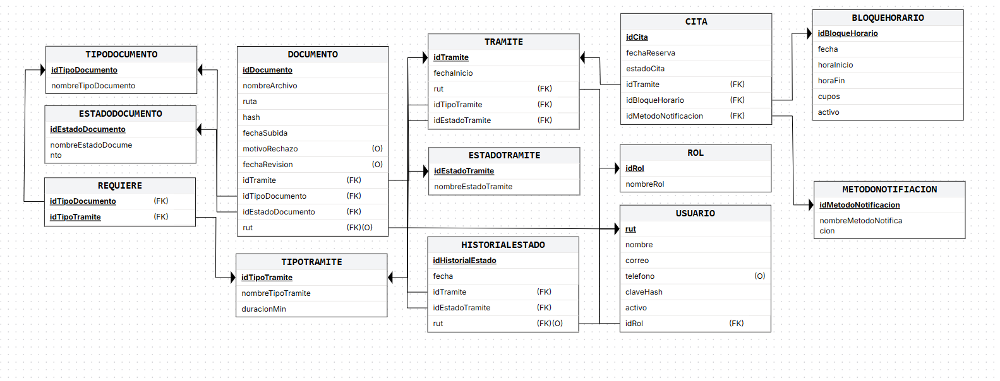
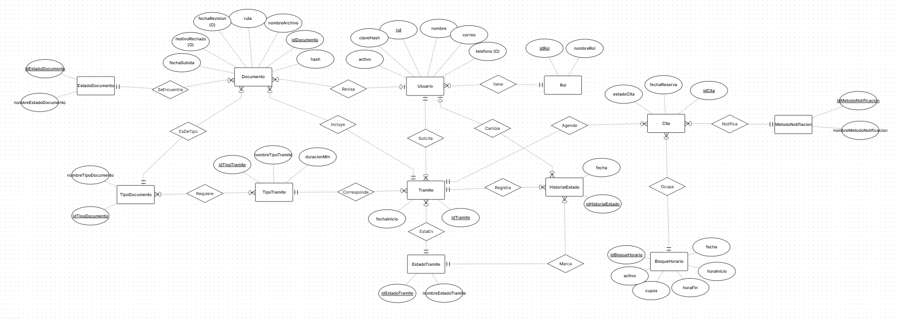

# Proyecto_Final_INF3245

# 1. Descripción y alcance
Dentro de esta segunda entrega, se paso el prototipo del frontend que tenia una sesion simulada, a un sistema con backend real, poniendo en foco lo que fue la seguridad, autenticacion y conttrol de acceso. Se construyo una API REST con Node.js, Express y PostgreSQL ademas de conectarse el frontend en Ionic + Reac mediante Axios.
Específicamente se trabajaron los temas relacionas con la autenticación de los usuarios, el control de acceso definido por roles, la seguridad de los datos, la integración con el frontend y por ultimo se dejo una colección de distintos casos de pruebas y documentación siendo tanto exitosos cómo de error.

| Función | Ubicación |Estado en el ejemplo | 
|---|---|---|
| Registro de usuario | --- | No implementado |
| Inicio de sesion | POST /api/auth/login  | Implementado |
| Validacion JTW y rutas protegidas | middlewares/authMiddleware.js | Implementado |
| Autorización por roles | autorizarRoles, autorizarPropioORoles | Implementado |
| CRUD de tramites, citas, usuarios, bloques horarios y documentos| /api/tramites, /api/citas, /api/documentos, /api/bloques_horarios, /api/usuarios | Implementado |
| Catalogos (tipos de estado, metodos de notificacion, roles| /api/tipos_tramite | Implementado |
| Historial de estados del tramite| GET /api/tramites/:id | Implementado |
| Calendario|  | Implementado |

# 2. Equipo, repositorio y trazabilidad
Nombre del equipo: Sistema de gestión de tramites en linea
Repositorio público:

https://github.com/CristobalFloresH/Sistema_Gestion_De_Transmites_En_Linea

Rama frontend: 

https://github.com/CristobalFloresH/Sistema_Gestion_De_Transmites_En_Linea/tree/frontend-EP2

Rama backend: 

https://github.com/CristobalFloresH/Sistema_Gestion_De_Transmites_En_Linea/tree/backend-EP2

Figma:

https://www.figma.com/design/GfTP09qFYtAsPHPTJxQtor/mockups?t=AJy5e1Ec4hsj2SAa-1

Integrantes y contribuciones

| Integrantes | Responsabilidad | Evidencia de colaboracion |
|---|---|---|
| Rafael Valdes | EP 2.3 API REST y endpoints CRUD. |  | 
| Diego Cortez | EP 2.4 Autenticación con JWT y roles. |  | 
| Mauricio Morales | EP 2.5 Seguridad y validación de usuarios. |  | 
| Cristóbal Flores | EP 2.6 Integración entre Ionic con React y el backend. |  | 

| Requerimientos EP1| Endpoints |
|---|---|
| RF-1 : Selección de bloque horario | GET /api/bloques_horario?fecha=  |
| RF-2 : Registro de reserva de cita | POST /api/citas  |
| RF-3 : Envío de comprobante de la cita |  |
| RF-4 : Carga de documentación | POST /api/document |
| RF-5 : Visualización de documentos adjuntos por el funcionario | GET /api/documentos, PATCH /api/documentos/:id |
| RF-6 : Validación de veracidad documental | GET /api/documentos, PATCH /api/documentos/:id |
| RF-7 : Visualización de la línea de tiempo del trámite | GET /api/tramites/:id |
| RF-8 : Redirección por roles de usuario | POST /api/auth/login |
| RF-9 : Notificación de licencia lista |  |
| RF-10 : Despliegue de agenda diaria | GET /api/citas?fechas=, GET /api/tramites?rut_ciudadano= |
| RF-11 : Envío recordatorio de cita |   |
| RF-12 : Cancelación de cita | PATCH /api/citas/:id |
| RF-13 : Búsqueda de tramites personal | GET /api/citas?fechas=, GET /api/tramites?rut_ciudadano= |
| RF-14 : Historial de trámites |   |
| RF-15 : Emision de comprobante |  |
| RF-16 : Configuración de bloques horarios | POST/PUT/PATCH/DELETE /api/bloques_horarios |
| RF-17 : Gestión de cuentas de funcionarios | GET/PUT/PATCH/DELETE api/usuarios |

# 3. Tecnologias
| Capa | Tecnologia identificada |
|---|---|
| Servidor | Nose.js + Express 5 |
| Base de datos | PostgreSQL |
| Autenticacion | jsonwebtoken |
| Seguridad |  |
| Pruebas | Insomnia |
| Frontend | Ionic + React |
| Frontend/Backend | Axios |


# 4. Arquitectura y carpetas reales
```
backend
├── base de datos 
│   └── licencias.sql     
├── package-lock.json
├── package.json
├── pruebas               
└── src
    ├── app.js            
    ├── config           
    ├── controllers       
    ├── middlewares       
    ├── routes            
    ├── services          
    └── utils             
```

```
Ionic + React
```

# 5. Preparacion y ejecucion local del ejemplo
## 5.1 Requisitos previos
- Node.js 20.19 o superior (probado con Node 24) y npm
- PostgreSQL (con pgAdmin)
- Insomnia, para las pruebas de la API
- Git

El backend y el frontend están en ramas distintas, así que se clonan por separado:
```bash
git clone -b backend-EP2 https://github.com/CristobalFloresH/Sistema_Gestion_De_Transmites_En_Linea.git backend-EP2
git clone -b frontend-EP2 https://github.com/CristobalFloresH/Sistema_Gestion_De_Transmites_En_Linea.git frontend-EP2
```

## 5.2 Base de datos
1. Crear la base `licencias`: en pgAdmin, clic derecho en *Databases* → *Create* → *Database…*, o ejecutar `create database licencias;` conectado a la base `postgres` (o a cualquier otra base existente).
2. Abrir el *Query Tool* **sobre la base `licencias`**, cargar [`backend/base de datos/licencias.sql`](https://github.com/CristobalFloresH/Sistema_Gestion_De_Transmites_En_Linea/blob/backend-EP2/backend/base%20de%20datos/licencias.sql) y ejecutarlo completo. La línea `create database` del script está comentada a propósito: el script solo crea las tablas en la base abierta.

El script crea las tablas, los catálogos, tres usuarios de prueba y los bloques horarios de los próximos 7 días hábiles desde el día en que se ejecuta. Se puede volver a ejecutar para dejar la base desde cero.

| Rol | RUT | Contraseña |
|---|---|---|
| Ciudadano | `20123456-5` | `Clave123!` |
| Funcionario | `12345678-5` | `Clave123!` |
| Administrador | `11111111-1` | `Clave123!` |

## 5.3 Iniciar Backend
En `backend-EP2/backend/`, copiar `.env.ejemplo` como `.env` y completar los valores:

| Variable | Qué es | Ejemplo |
|---|---|---|
| `DB_HOST`, `DB_PORT` | Servidor de PostgreSQL | `localhost`, `5432` |
| `DB_NAME` | Base de datos | `licencias` |
| `DB_USER`, `DB_PASSWORD` | Usuario y contraseña de PostgreSQL | `postgres`, la de cada uno |
| `JWT_SECRET` | Clave para firmar los tokens (una cadena larga y aleatoria) | — |
| `JWT_EXPIRES_IN` | Duración del token | `2h` |

En una **primera terminal**:
```bash
cd backend-EP2/backend
npm install
npm run dev
```
La API queda en `http://localhost:3000/api` y la consola muestra "Conectado a PostgreSQL". Esta terminal debe quedar abierta.

## 5.4 Iniciar Frontend
En una **segunda terminal**, sin cerrar la del backend:
```bash
cd frontend-EP2/frontend
npm install
npm run dev
```
La aplicación queda en `http://localhost:5173`. Por defecto usa la API en `http://localhost:3000/api`; para otra dirección, definir `VITE_API_URL` en un archivo `.env` del frontend.

## 5.5 Problemas frecuentes
| Síntoma | Qué revisar |
|---|---|
| "No se pudo conectar con el servidor" en la app | Que el backend esté corriendo en el puerto 3000 |
| Error de conexión a PostgreSQL al iniciar el backend | Que el servicio de PostgreSQL esté activo y los datos del `.env` sean correctos |
| `relation ... does not exist` | El script se ejecutó en otra base (por ejemplo `postgres`) en vez de `licencias` |
| Error de CORS en el navegador | El frontend debe estar en el puerto 5173; si Vite usa otro (5174) es porque el 5173 está ocupado |
| "No hay horas disponibles" en todos los días | Los bloques se generan para 7 días hábiles desde que se creó la base; volver a ejecutar `licencias.sql` |
| La sesión se cierra sola | El token dura 2 horas (`JWT_EXPIRES_IN`); volver a iniciar sesión |

# 6. Documentacion de la API existente


# 7. Seguridad y JWT: estado y correcciones necesarias
| Control EP2 | Estado en este proyecto | Evidencia | Mejora pendiente |
|---|---|---|---|
| JWT con expiración | Sí. El token se firma con HS256 y dura 2 horas por defecto, configurable con `JWT_EXPIRES_IN`. | `utils/jwt.js` | Definir con el grupo si 2 h es adecuado |
| Claims mínimos en el JWT | Sí. El token solo lleva `rut` y `rol`, sin contraseña ni datos personales. | `authController.js` | Ninguna |
| Rutas protegidas en backend | Sí. Usuarios, trámites, citas, documentos y bloques horarios exigen token válido y responden 401 si falta o expiró. | `middlewares/authMiddleware.js`, archivos `*Routes.js` | Los catálogos son públicos a propósito (solo lectura) |
| Roles diferenciados | Sí. Hay tres roles (ciudadano, funcionario, administrador) con los middlewares `autorizarRoles` y `autorizarPropioORoles`, que responden 403. El rol lo asigna siempre el servidor al registrar. | `authMiddleware.js`, `authService.js` | Faltan controles de dueño en el detalle de trámites y citas, y en los documentos |
| bcrypt | Sí. El registro guarda el hash con `bcrypt.hash` (10 rondas) y el login usa `bcrypt.compare`. | `utils/claves.js`, `authController.js` | Ninguna |
| Secretos en variables de entorno | Sí. `JWT_SECRET` y las credenciales de PostgreSQL se leen desde `.env`. En el repositorio solo está `.env.ejemplo`. | `utils/jwt.js`, `config/db.js`, `.env.ejemplo` | Exigir un largo mínimo a `JWT_SECRET` |
| Validación de entradas | Sí. Se validan RUT, nombre, correo, teléfono, id, fechas y largos máximos, y se rechazan campos desconocidos. La contraseña exige 8 caracteres o más, mayúscula, minúscula, número y símbolo. | `utils/apoyoControladores.js`, `utils/validacionClave.js` | Opcional: usar una librería de validación |
| Prevención de SQL injection | Sí. Todas las consultas usan parámetros (`$1`, `$2`). | `services/*.js` | Ninguna |
| Minimización de datos | Sí. Ninguna respuesta incluye `clave_hash` y el JWT no lleva datos sensibles. | `authService.js`, `usuarioService.js` | Ninguna |
| Protección de rutas frontend | Pendiente de confirmar con el equipo de frontend. | — | Guardias de ruta en Ionic React y manejo de token expirado |
| Manejo de errores | Sí. Un manejador central responde 500 genérico y registra el detalle solo en consola. El login da el mismo mensaje para un RUT inexistente y una contraseña mala, y una petición sin cuerpo responde 400. | `app.js`, `authController.js` | Opcional: límite de intentos de login |
| Pruebas de seguridad | Pruebas en Insomnia de casos de éxito y de error: login, registro con contraseña débil, registro repetido y rutas con y sin token. | `pruebas/insomnia-auth.json` | Exportar la colección y subirla al repositorio |

# 8. Integración frontend-backend
El frontend ([rama `frontend-EP2`](https://github.com/CristobalFloresH/Sistema_Gestion_De_Transmites_En_Linea/tree/frontend-EP2/frontend)) consume esta API con **Axios**. Todas las pantallas obtienen sus datos del backend; ya no quedan datos escritos en el código.

## 8.1 Cliente HTTP y servicios
El frontend se comunica con la API mediante un cliente Axios y un servicio por recurso.

| Pieza | Qué hace |
|---|---|
| Cliente ([`api.js`](https://github.com/CristobalFloresH/Sistema_Gestion_De_Transmites_En_Linea/blob/frontend-EP2/frontend/src/services/api.js)) | Instancia única de Axios con `baseURL` (`VITE_API_URL` o `http://localhost:3000/api`) y un timeout de 10 s |
| Servicios ([`src/services/`](https://github.com/CristobalFloresH/Sistema_Gestion_De_Transmites_En_Linea/tree/frontend-EP2/frontend/src/services)) | Un archivo por recurso (trámites, citas, documentos, bloques, catálogos y sesión). Las funciones devuelven directamente los `datos` de la respuesta |
| Páginas | No escriben URLs ni usan Axios directamente: solo llaman a los servicios. Si cambia una ruta del backend, se corrige en un solo archivo |

Se eligió Axios en vez de `fetch` porque trae interceptores (ver 8.2 y 8.4), convierte el JSON automáticamente y permite enviar los filtros como `params`. La lista completa de servicios y endpoints está en la 8.6.

## 8.2 Envío del JWT y manejo de la sesión
La sesión se maneja en [`services/sesion.js`](https://github.com/CristobalFloresH/Sistema_Gestion_De_Transmites_En_Linea/blob/frontend-EP2/frontend/src/services/sesion.js) y en los interceptores de [`services/api.js`](https://github.com/CristobalFloresH/Sistema_Gestion_De_Transmites_En_Linea/blob/frontend-EP2/frontend/src/services/api.js).

| Momento | Qué hace el frontend |
|---|---|
| Inicio de sesión | `login` guarda en `localStorage` el token y los datos del usuario (`rut`, `nombre`, `rol`) con `guardarSesion` |
| Cada petición | El interceptor de petición agrega `Authorization: Bearer <token>` si hay sesión, así ninguna pantalla lo envía a mano |
| Token vencido | `getToken` lee el `exp` del JWT; si ya venció, borra la sesión y no envía el token |
| Respuesta 401 | El interceptor de respuesta borra la sesión y redirige a `/login` (salvo en el propio login, donde 401 significa "clave incorrecta") |
| Cerrar sesión | El botón "Cerrar sesion" del menú llama a `logout`, que borra el token y los datos guardados |

El token dura 2 horas (`JWT_EXPIRES_IN` del backend). Se eligió `localStorage` por simplicidad y porque la sesión se mantiene al recargar la página; una alternativa más segura frente a XSS serían las cookies `httpOnly`, que quedan como mejora.

## 8.3 Protección de rutas por rol
Las rutas se protegen con [`routes/ProtectedRoute.jsx`](https://github.com/CristobalFloresH/Sistema_Gestion_De_Transmites_En_Linea/blob/frontend-EP2/frontend/src/routes/ProtectedRoute.jsx), aplicado en [`App.jsx`](https://github.com/CristobalFloresH/Sistema_Gestion_De_Transmites_En_Linea/blob/frontend-EP2/frontend/src/App.jsx).

| Rutas | Quién puede entrar | Si no cumple |
|---|---|---|
| `/`, `/login` | Cualquiera (públicas) | — |
| `/tramite-licencia`, `/calendario`, `/tramite-finalizado`, `/mis-tramites` | Cualquier usuario con sesión | Sin sesión → `/login` |
| `/funcionario/agenda`, `/funcionario/tramites/:idTramite` | Funcionario o administrador | Sin sesión → `/login`; ciudadano → `/` |

Al iniciar sesión, cada rol llega a su pantalla (RF-8): el personal a `/funcionario/agenda` y el ciudadano a `/`, y el menú muestra solo las opciones de su rol. `ProtectedRoute` vuelve a leer la sesión cada vez que se entra a una página, así un token vencido saca al usuario aunque la página siga montada. Esta protección es de interfaz: la seguridad real está en el backend, que valida el token y el rol en cada petición (ver sección 7).

## 8.4 Manejo de errores
El interceptor de respuesta de [`api.js`](https://github.com/CristobalFloresH/Sistema_Gestion_De_Transmites_En_Linea/blob/frontend-EP2/frontend/src/services/api.js) convierte cualquier error en un `Error` con `.mensaje` (texto para el usuario) y `.status` (código HTTP), así todas las pantallas lo manejan igual.

| Caso | Qué ve el usuario |
|---|---|
| Backend no disponible | "No se pudo conectar con el servidor. Revisa tu conexión o inténtalo nuevamente." |
| Sin respuesta en 10 s | "El servidor tardó demasiado en responder. Intenta de nuevo." |
| Error con mensaje del backend (`{ error: { mensaje, detalles } }`) | Ese mensaje, por ejemplo "El bloque horario no tiene cupos disponibles" |
| 401 | Se cierra la sesión y vuelve al login (ver 8.2) |
| 403 / 404 sin mensaje | "No tienes permiso para hacer esto." / "No se encontró lo que buscabas." |
| 500 o más | "Hubo un problema en el servidor. Intenta más tarde." |

En las pantallas, mientras se cargan los datos se muestra un spinner; si falla la carga, el mensaje aparece en lugar del contenido, y si no hay datos se indica (por ejemplo "No hay horas disponibles este día"). Los errores de acciones se muestran en rojo: junto al botón en la reserva, o en un aviso al cancelar, reagendar, aprobar o rechazar. Si una reserva falla a medio camino, al reintentar se reutilizan el trámite y los documentos ya creados, sin duplicarlos.

## 8.5 Flujos con datos reales
Todas las pantallas leen y guardan sus datos en el backend.

| Pantalla | Qué hace | Servicios que usa | RF |
|---|---|---|---|
| [Login](https://github.com/CristobalFloresH/Sistema_Gestion_De_Transmites_En_Linea/blob/frontend-EP2/frontend/src/pages/Login.jsx) | Inicia sesión y redirige según el rol | [`authService`](https://github.com/CristobalFloresH/Sistema_Gestion_De_Transmites_En_Linea/blob/frontend-EP2/frontend/src/services/authService.js) | RF-8 |
| [Trámite de licencia](https://github.com/CristobalFloresH/Sistema_Gestion_De_Transmites_En_Linea/blob/frontend-EP2/frontend/src/pages/TramiteLicencia.jsx) | Muestra los tipos de trámite con sus documentos, las horas de los próximos 7 días y los métodos de aviso. "Continuar" crea el trámite, registra los documentos y reserva la cita | [`catalogoService`](https://github.com/CristobalFloresH/Sistema_Gestion_De_Transmites_En_Linea/blob/frontend-EP2/frontend/src/services/catalogoService.js), [`bloqueHorarioService`](https://github.com/CristobalFloresH/Sistema_Gestion_De_Transmites_En_Linea/blob/frontend-EP2/frontend/src/services/bloqueHorarioService.js), [`tramiteService`](https://github.com/CristobalFloresH/Sistema_Gestion_De_Transmites_En_Linea/blob/frontend-EP2/frontend/src/services/tramiteService.js), [`documentoService`](https://github.com/CristobalFloresH/Sistema_Gestion_De_Transmites_En_Linea/blob/frontend-EP2/frontend/src/services/documentoService.js), [`citaService`](https://github.com/CristobalFloresH/Sistema_Gestion_De_Transmites_En_Linea/blob/frontend-EP2/frontend/src/services/citaService.js) | RF-1, RF-2, RF-4 |
| [Calendario](https://github.com/CristobalFloresH/Sistema_Gestion_De_Transmites_En_Linea/blob/frontend-EP2/frontend/src/pages/Calendario.jsx) | Muestra los bloques de cualquier fecha con sus cupos; también se usa para reagendar una cita | [`bloqueHorarioService`](https://github.com/CristobalFloresH/Sistema_Gestion_De_Transmites_En_Linea/blob/frontend-EP2/frontend/src/services/bloqueHorarioService.js), [`citaService`](https://github.com/CristobalFloresH/Sistema_Gestion_De_Transmites_En_Linea/blob/frontend-EP2/frontend/src/services/citaService.js) | RF-1 |
| [Trámite finalizado](https://github.com/CristobalFloresH/Sistema_Gestion_De_Transmites_En_Linea/blob/frontend-EP2/frontend/src/pages/TramiteFinalizado.jsx) | Muestra los datos de la reserva recién hecha (recibidos de la pantalla anterior, sin nueva petición) | — | RF-2 |
| [Mis trámites](https://github.com/CristobalFloresH/Sistema_Gestion_De_Transmites_En_Linea/blob/frontend-EP2/frontend/src/pages/MisTramites.jsx) | Lista los trámites y citas propios con su avance, y permite cancelar, reagendar y ver el historial | [`tramiteService`](https://github.com/CristobalFloresH/Sistema_Gestion_De_Transmites_En_Linea/blob/frontend-EP2/frontend/src/services/tramiteService.js), [`citaService`](https://github.com/CristobalFloresH/Sistema_Gestion_De_Transmites_En_Linea/blob/frontend-EP2/frontend/src/services/citaService.js) | RF-7, RF-12, RF-14 |
| [Agenda (funcionario)](https://github.com/CristobalFloresH/Sistema_Gestion_De_Transmites_En_Linea/blob/frontend-EP2/frontend/src/pages/AgendaFuncionario.jsx) | Lista todas las citas con su trámite, con filtros por estado y tipo, y búsqueda por RUT o nombre | [`citaService`](https://github.com/CristobalFloresH/Sistema_Gestion_De_Transmites_En_Linea/blob/frontend-EP2/frontend/src/services/citaService.js), [`tramiteService`](https://github.com/CristobalFloresH/Sistema_Gestion_De_Transmites_En_Linea/blob/frontend-EP2/frontend/src/services/tramiteService.js), [`catalogoService`](https://github.com/CristobalFloresH/Sistema_Gestion_De_Transmites_En_Linea/blob/frontend-EP2/frontend/src/services/catalogoService.js) | RF-10, RF-13 |
| [Proceso del trámite (funcionario)](https://github.com/CristobalFloresH/Sistema_Gestion_De_Transmites_En_Linea/blob/frontend-EP2/frontend/src/pages/AgendaProceso.jsx) | Muestra el trámite, sus documentos y el historial del ciudadano; permite aprobar, avanzar de etapa o rechazar | [`tramiteService`](https://github.com/CristobalFloresH/Sistema_Gestion_De_Transmites_En_Linea/blob/frontend-EP2/frontend/src/services/tramiteService.js), [`documentoService`](https://github.com/CristobalFloresH/Sistema_Gestion_De_Transmites_En_Linea/blob/frontend-EP2/frontend/src/services/documentoService.js), [`citaService`](https://github.com/CristobalFloresH/Sistema_Gestion_De_Transmites_En_Linea/blob/frontend-EP2/frontend/src/services/citaService.js) | RF-5, RF-6, RF-14 |

Simulado por ahora: la carga de documentos guarda solo el nombre del archivo (el PDF no se sube al servidor) y el botón "Descargar comprobante".

## 8.6 Servicios y endpoints
Qué endpoint llama cada servicio. Junto con la 8.5 se lee la cadena completa: pantalla → servicio → endpoint.

| Servicio | Funciones | Endpoints |
|---|---|---|
| [`authService.js`](https://github.com/CristobalFloresH/Sistema_Gestion_De_Transmites_En_Linea/blob/frontend-EP2/frontend/src/services/authService.js) | `login`, `logout` | [`POST /auth/login`](https://github.com/CristobalFloresH/Sistema_Gestion_De_Transmites_En_Linea/blob/backend-EP2/backend/src/routes/authRoutes.js) |
| [`catalogoService.js`](https://github.com/CristobalFloresH/Sistema_Gestion_De_Transmites_En_Linea/blob/frontend-EP2/frontend/src/services/catalogoService.js) | `listarTiposTramite`, `listarMetodosNotificacion`, `listarEstadosTramite` | [`GET /tipos_tramite`](https://github.com/CristobalFloresH/Sistema_Gestion_De_Transmites_En_Linea/blob/backend-EP2/backend/src/routes/catalogoRoutes.js), [`GET /metodos_notificacion`](https://github.com/CristobalFloresH/Sistema_Gestion_De_Transmites_En_Linea/blob/backend-EP2/backend/src/routes/catalogoRoutes.js), [`GET /estados_tramite`](https://github.com/CristobalFloresH/Sistema_Gestion_De_Transmites_En_Linea/blob/backend-EP2/backend/src/routes/catalogoRoutes.js) |
| [`bloqueHorarioService.js`](https://github.com/CristobalFloresH/Sistema_Gestion_De_Transmites_En_Linea/blob/frontend-EP2/frontend/src/services/bloqueHorarioService.js) | `listarBloquesPorFecha` | [`GET /bloques_horarios?fecha&activo=true`](https://github.com/CristobalFloresH/Sistema_Gestion_De_Transmites_En_Linea/blob/backend-EP2/backend/src/routes/bloqueHorarioRoutes.js) |
| [`tramiteService.js`](https://github.com/CristobalFloresH/Sistema_Gestion_De_Transmites_En_Linea/blob/frontend-EP2/frontend/src/services/tramiteService.js) | `crearTramite`, `listarTramites`, `obtenerTramite`, `cambiarEstadoTramite` | [`POST /tramites`](https://github.com/CristobalFloresH/Sistema_Gestion_De_Transmites_En_Linea/blob/backend-EP2/backend/src/routes/tramiteRoutes.js), [`GET /tramites`](https://github.com/CristobalFloresH/Sistema_Gestion_De_Transmites_En_Linea/blob/backend-EP2/backend/src/routes/tramiteRoutes.js), [`GET /tramites/:id`](https://github.com/CristobalFloresH/Sistema_Gestion_De_Transmites_En_Linea/blob/backend-EP2/backend/src/routes/tramiteRoutes.js), [`PATCH /tramites/:id`](https://github.com/CristobalFloresH/Sistema_Gestion_De_Transmites_En_Linea/blob/backend-EP2/backend/src/routes/tramiteRoutes.js) |
| [`citaService.js`](https://github.com/CristobalFloresH/Sistema_Gestion_De_Transmites_En_Linea/blob/frontend-EP2/frontend/src/services/citaService.js) | `crearCita`, `listarCitas`, `listarCitasVigentes`, `cancelarCita`, `reagendarCita` | [`POST /citas`](https://github.com/CristobalFloresH/Sistema_Gestion_De_Transmites_En_Linea/blob/backend-EP2/backend/src/routes/citaRoutes.js), [`GET /citas`](https://github.com/CristobalFloresH/Sistema_Gestion_De_Transmites_En_Linea/blob/backend-EP2/backend/src/routes/citaRoutes.js), [`PATCH /citas/:id`](https://github.com/CristobalFloresH/Sistema_Gestion_De_Transmites_En_Linea/blob/backend-EP2/backend/src/routes/citaRoutes.js) |
| [`documentoService.js`](https://github.com/CristobalFloresH/Sistema_Gestion_De_Transmites_En_Linea/blob/frontend-EP2/frontend/src/services/documentoService.js) | `crearDocumento`, `listarDocumentos` | [`POST /documentos`](https://github.com/CristobalFloresH/Sistema_Gestion_De_Transmites_En_Linea/blob/backend-EP2/backend/src/routes/documentoRoutes.js), [`GET /documentos?id_tramite`](https://github.com/CristobalFloresH/Sistema_Gestion_De_Transmites_En_Linea/blob/backend-EP2/backend/src/routes/documentoRoutes.js) |

Las rutas no incluyen `/api` porque ya va en el `baseURL`.


# 9. Pruebas funcionales y evidencia EP2


# 10. Modelo relacional
Base de datos PostgreSQL, con las distintas claves primarias, claves foraneas y restricciones.
### Esquema relacional

### Modelo Entidad-Relacion

# 11. Matriz de cumplimiento EP2
| Criterio | Evidencia exigida | Estado |
|---|---|---|
| EP 2.1 Servidor backend funcional | scr/app.js |  Implementado |
| EP 2.2 Base de datos relacional y archivo .sql. | licencias.sql, config/db.js | Implementado |
| EP 2.3 API REST y endpoints CRUD | GET, POST, PUT, PATCH y DELETE  | Implementado |
| EP 2.4 Autenticación con JWT y roles | utils/jwt.js, authController, authMiddleware | Implementado |
| EP 2.5 Seguridad y validación de usuarios. | bcrypt, consultar parametrizadas | Implementado |
| EP 2.6 Integración entre Ionic con React y el backend. | frontend-EP2, login, registrio y calendario con Axios | Implementado |
| EP 2.7 Pruebas funcionales y documentaci´on de endpoints | pruebas/ | Implementado |
| Documentación | README y las ramas de backend-EP2 y frontend-EP2| Implementado |

# 12. Listas de verificacion antes de entrega

- [ ] Repositorio público, ramas y commits verificables.
- [ ] Nombres del equipo, responsabilidades y enlaces completos.
- [ ] Frontend realizado en Ionic + React (no Angular).
- [ ] Backend arranca siguiendo los comandos del README.
- [ ] Base de datos relacional se crea desde .sql y se conecta al backend.
- [ ] GET, POST, PUT/PATCH y DELETE implementados para recursos pertinentes.
- [ ] Registro, login, JWT con expiración y rutas protegidas.
- [ ] Al menos dos roles con autorización diferenciada.
- [ ] Contraseñas con bcrypt, consultas parametrizadas y secretos fuera de GitHub.
- [ ] Frontend consume datos reales y maneja errores/tokens.
- [ ] Colección Postman/Insomnia, respuestas y pruebas de error.
- [ ] Capturas, diagramas y enlaces de Markdown son reales y funcionan.
- [ ] Trazabilidad de requerimientos EP1 → funcionalidades implementadas en EP2.


